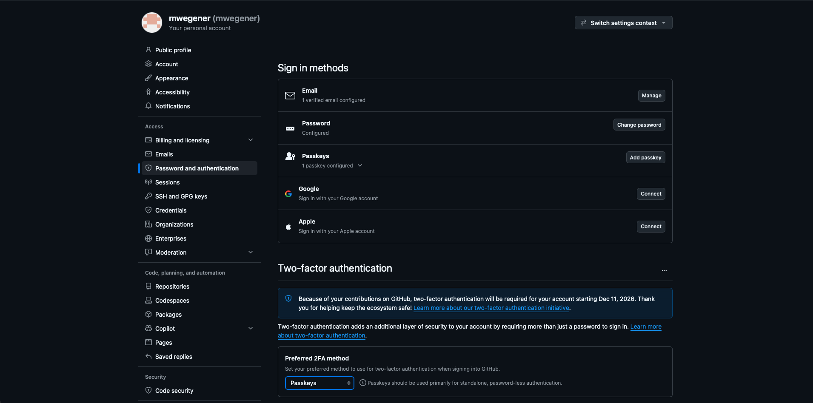
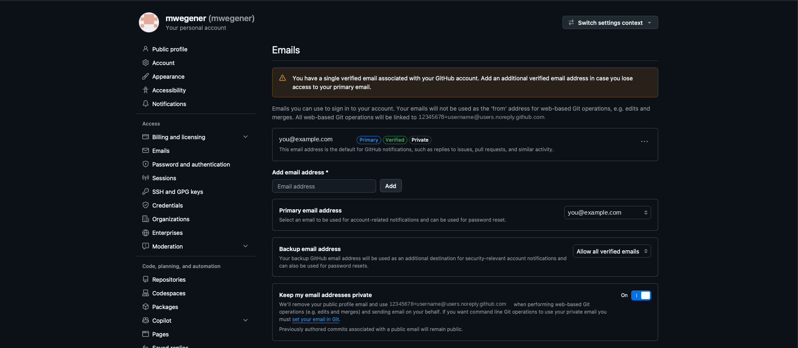
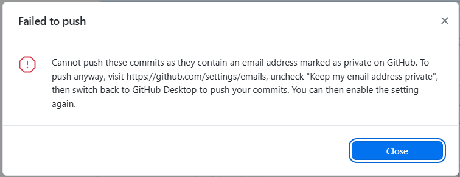
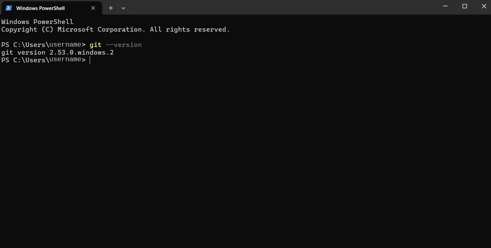
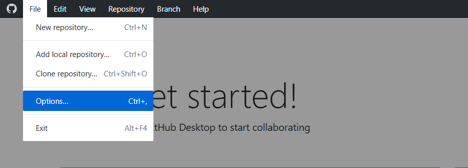
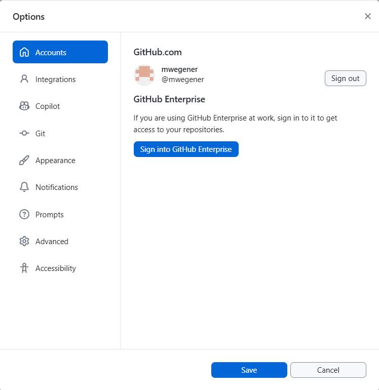
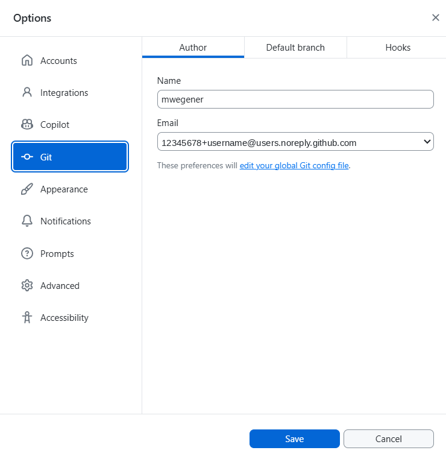

## 1. Create a GitHub account

1. Go to [github.com/signup](https://github.com/signup).
2. Choose a **professional username**. It appears on everything you do, for example `jsmith-nv` rather than `pizzalover99`.
3. **Turn on two-factor authentication (2FA):** profile picture → **Settings → Password and authentication**. NV OSE requires 2FA for all organization members.

   {fig-alt="GitHub's Password and authentication settings page. Sign in methods are listed (email, password, passkeys, Google, Apple), and below them the Two-factor authentication section with a Preferred 2FA method set to Passkeys."}
4. Optional: if you use a personal account for work, add your work email under **Settings → Emails**.

### Protect your email address

Every commit is labeled with an email address, and in public repos anyone can see it. To keep yours private:

1. Go to **Settings → Emails** and check **Keep my email addresses private**.
2. GitHub then shows you a private "noreply" address, like `12345678+username@users.noreply.github.com`. Use that address when you configure Git (below).

::: {.annotated}
{fig-alt="GitHub's Emails settings page. It lists one verified email address and shows the account's noreply address for web-based Git operations. At the bottom, the Keep my email addresses private setting is turned on, marked with a red box."}
[]{.red-box style="left:78.5%; top:82%; width:3.7%; height:5.5%;"}
:::

::: {.callout-warning title="Push failed because of a private email?"}
::: {style="max-width:70%"}
{fig-alt="A GitHub Desktop error titled Failed to push: Cannot push these commits as they contain an email address marked as private on GitHub. It suggests unchecking Keep my email address private."}
:::

This means Git is committing with your **private** email. **Don't** turn off email privacy as the message suggests. Instead, set your Git email to your **noreply** address ([step 3](#connect-github-desktop)), then undo and redo the commit.
:::

## 2. Install the tools

| Tool | Windows | Mac (if you use one) |
|---|---|---|
| **GitHub Desktop** | [Download GitHub Desktop](https://desktop.github.com/download/) (Windows version) | Same link (Mac version) |
| **Git** (for the command line) | Install [Git for Windows](https://git-scm.com/download/win) and accept the defaults. It includes **Git Bash** and **Git Credential Manager** | Open Terminal and type `git --version`; macOS offers to install it |
| **Editor** | [Positron](https://positron.posit.co/), [VS Code](https://code.visualstudio.com/), or RStudio | Same |

::: {.callout-note}
On a state computer you may need IT to install software. Request it ahead of time.
:::

### Show file extensions and hidden files (Windows)

By default, Windows **hides file extensions** (so `report.qmd` shows as just `report`) and **hides some files**. You'll be working with files like `.gitignore`, `.here`, and `.Renviron`, so turn both on:

1. Open **File Explorer**.
2. Click **View** (top menu) → **Show** → check **File name extensions** and **Hidden items**.
   On Windows 10: the **View** tab → check **File name extensions** and **Hidden items**.

Check that Git works. Open **Git Bash** (Start menu → type `Git Bash`) or **Command Prompt**, and run:

```bash
git --version
```

You should see something like `git version 2.53.0.windows.2`:

{fig-alt="Windows PowerShell after running git --version, which prints git version 2.53.0.windows.2."}

## 3. Connect GitHub Desktop {#connect-github-desktop}

1. Open GitHub Desktop and go to **File → Options…** (Mac: **GitHub Desktop → Settings**).

::: {.annotated style="max-width:60%"}
{fig-alt="GitHub Desktop's File menu with Options… (shortcut Ctrl+,) marked with a red box. Other items are New repository, Add local repository, Clone repository, and Exit."}
[]{.red-box style="left:4.5%; top:53%; width:28.5%; height:13.5%;"}
:::

2. Under **Accounts**, click **Sign in** for GitHub.com. Your browser opens; sign in to GitHub and authorize the app. When it's done, your account appears:

::: {style="max-width:55%"}
{fig-alt="The Accounts page of GitHub Desktop's Options, showing a signed-in GitHub.com account with a Sign out button, and a Sign into GitHub Enterprise button below."}
:::

3. Under **Git → Author**, set your **Name**, and choose your **noreply** address in the **Email** dropdown. Click **Save**.

::: {style="max-width:55%"}
{fig-alt="The Git page of GitHub Desktop's Options, on the Author tab. The Name field has a username, and the Email dropdown shows a noreply address ending in @users.noreply.github.com."}
:::

4. Under **Git → Default branch**, leave it as **main**.

## 4. Configure Git for the command line

Tell Git who you are. Do this once per computer:

```bash
git config --global user.name "Your Name"
git config --global user.email "your-noreply-or-work-email@example.com"
git config --global init.defaultBranch main
```

Check your settings:

```bash
git config --list
```

## 5. Authenticate the command line

GitHub **no longer accepts your password** for Git on the command line. Use one of these instead:

- **Easiest (Windows):** Git for Windows includes Git Credential Manager. The first time you push, a browser window opens so you can sign in.
- **Alternative:** install the [GitHub CLI](https://cli.github.com/) and run:
  ```bash
  gh auth login
  ```
  Follow the prompts and choose **HTTPS** and **Login with a web browser**.
- **Alternative:** a [personal access token](https://docs.github.com/en/authentication/keeping-your-account-and-data-secure/managing-your-personal-access-tokens) or an [SSH key](https://docs.github.com/en/authentication/connecting-to-github-with-ssh). These are more advanced.

::: {.callout-warning}
A token works like a password. Never paste it into code, a README, or a chat. See [Lesson 9](09-data-security.qmd).
:::

## Checklist

- [ ] GitHub account created, with 2FA on
- [ ] Email privacy set
- [ ] GitHub Desktop installed and signed in
- [ ] Git installed (`git --version` works)
- [ ] `user.name` and `user.email` configured
- [ ] Accepted the invitation to the **nv-ose** organization (check your email or [github.com/nv-ose](https://github.com/nv-ose))
