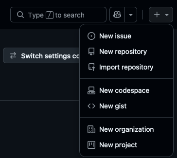
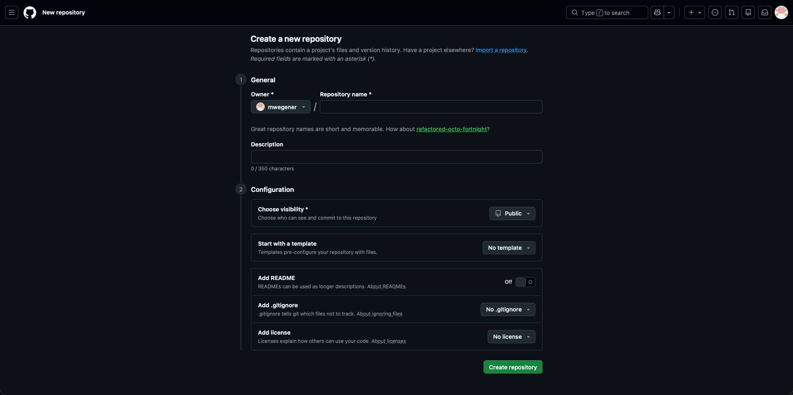
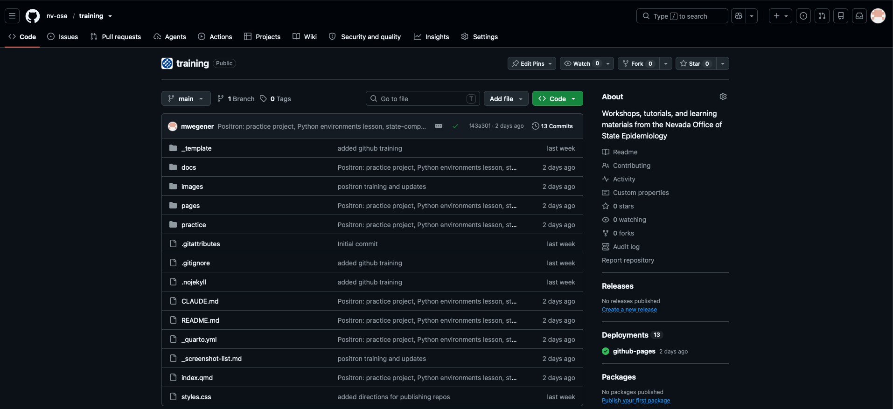
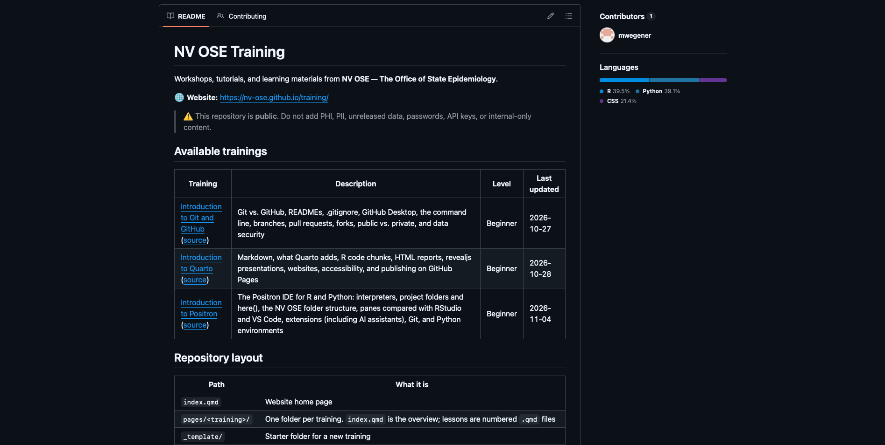
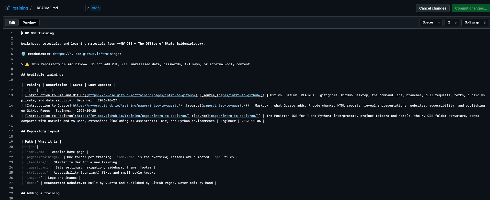
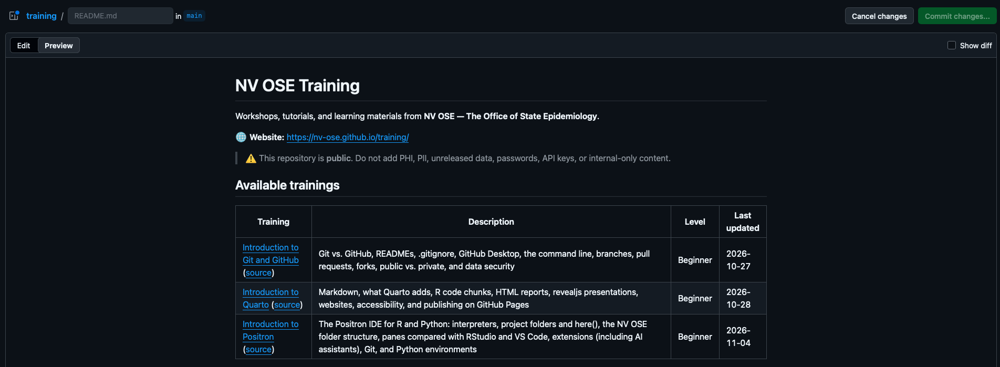
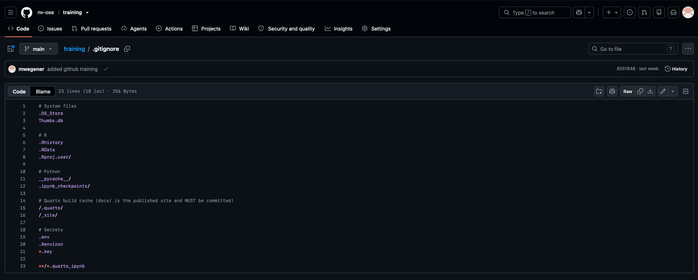

## What is a repository?

A **repository (repo)** is a project folder that Git tracks. It contains:

- your files (code, documents, small example data)
- a hidden `.git` folder that stores the complete history. **Don't edit or delete it.**

A good rule is **one project per repo**.

## Creating a repository on GitHub

1. Click **+** (top right) → **New repository**.

::: {.annotated style="max-width:35%"}
{fig-alt="GitHub's + menu opened from the top right of the page, with New repository marked with a red box. Other items are New issue, Import repository, New codespace, New gist, New organization, and New project."}
[]{.red-box style="left:45%; top:28%; width:52%; height:9.5%;"}
:::

2. Fill in the form:

{fig-alt="GitHub's Create a new repository form. Under General: Owner and Repository name fields, and a Description field. Under Configuration: Choose visibility (set to Public), Start with a template, an Add README toggle, Add .gitignore, and Add license dropdowns, and a green Create repository button."}

   - **Owner:** choose `nv-ose` for team work, or your own account for practice.
   - **Repository name:** lowercase with hyphens, like `flu-dashboard`. See the [SOP naming rules](https://github.com/nv-ose/.github/blob/main/CONTRIBUTING.md).
   - **Description:** one sentence.
   - **Choose visibility:** Public or Private. See [Lesson 8](08-public-vs-private.qmd). **When in doubt, choose Private.**
   - **Add README:** turn it **On**.
   - **Add .gitignore:** choose a template, such as **R** or **Python**.
   - **Add license:** CC BY 4.0 for documents, MIT for code. This mostly matters for public repos.
3. Click **Create repository**.

Your new repository's page lists its files, with branch, **Add file**, and **Code** buttons above them:

{fig-alt="The nv-ose/training repository page on GitHub. Tabs across the top include Code, Issues, Pull requests, Actions, and Settings. Above the file list are the main branch selector, Go to file, Add file, and a green Code button. The file list shows folders and files with their last commit messages, and an About panel is on the right."}

## README.md

The README is the **front page** of your repo. GitHub displays it automatically below the file list. It's written in **Markdown**, a simple formatting language.

{fig-alt="A README displayed on a GitHub repository page, below the file list: a large NV OSE Training heading, a description, a website link, a warning that the repository is public, and an Available trainings table."}

### A good README answers

- **What** is this?
- **Who** is it for, and who maintains it?
- **How** do I use it? What software do I need, and in what order do I run the scripts?
- **What's in** each folder?
- **When** was it last updated?

::: {.callout-tip title="README guide and template"}
See **[Writing a good README](readme-guide.qmd)** for what to include, tips, examples, and a downloadable NV OSE template.
:::

### Editing a file on GitHub

You can edit a README (or any text file) right in the browser:

1. Open the file and click the **pencil** icon (**Edit file**).

::: {.annotated}
{fig-alt="The header bar above a README on GitHub, with README and Contributing tabs on the left and an Edit file pencil icon on the right, marked with a red box and showing an Edit file tooltip."}
[]{.red-box style="left:79.3%; top:5%; width:3.2%; height:52%;"}
:::

2. Make your changes on the **Edit** tab:

{fig-alt="GitHub's file editor for README.md, on the Edit tab. The Markdown source is shown with line numbers, and Cancel changes and Commit changes buttons are at the top right."}

3. Click **Preview** to check the formatting:

{fig-alt="The same editor on the Preview tab, showing the README formatted: the NV OSE Training heading, a website link, the public-repository warning, and the trainings table."}

4. Click **Commit changes…**, write a short message, and for shared repos choose **Create a new branch… and start a pull request** ([Lesson 6](06-branches-pull-requests.qmd)).

### Markdown basics

| You type | You get |
|---|---|
| `# Heading` | Large heading |
| `## Subheading` | Smaller heading |
| `**bold**` | **bold** |
| `*italic*` | *italic* |
| `- item` | Bulleted list |
| `1. item` | Numbered list |
| `[link text](https://example.com)` | [link text](https://example.com) |
| `` `code` `` | `code` |
| `` | An image |

For a block of code, put three backticks (```` ``` ````) on the lines before and after it.

GitHub's [Markdown guide](https://docs.github.com/en/get-started/writing-on-github/getting-started-with-writing-and-formatting-on-github/basic-writing-and-formatting-syntax) covers more.

## .gitignore

A `.gitignore` file tells Git which files to **never track**. It's one of your most important safety tools.

```gitignore
# Operating-system clutter
.DS_Store
Thumbs.db

# R
.Rhistory
.RData
.Rproj.user/

# Python
__pycache__/
.venv/

# Secrets: NEVER commit these
.env
*.key
credentials.json

# Data: keep real data out of Git
data/raw/
*.sas7bdat
*.xlsx
```

Here's the `.gitignore` for this training site, viewed on GitHub:

{fig-alt="A .gitignore file opened on GitHub, 23 lines long, with comment headings for System files, R, Python, Quarto build cache, and Secrets, each followed by patterns such as .DS_Store, .Rhistory, __pycache__/, /.quarto/, .env, .Renviron, and *.key."}

### How it works

- Each line is a pattern. `*` matches anything, a trailing `/` means a folder, and `#` starts a comment.
- Ignored files stay on your computer. Git just doesn't track them or upload them.
- GitHub has ready-made templates in the [github/gitignore](https://github.com/github/gitignore) repo.

### Gotcha: .gitignore doesn't affect files already tracked

If a file was committed *before* you added it to `.gitignore`, Git keeps tracking it. To stop tracking it, but keep it on your computer:

```bash
git rm --cached path/to/file
git commit -m "Stop tracking file"
```

The file still exists in **earlier commits**. If it contained sensitive information, see [Lesson 9](09-data-security.qmd).

::: {.callout-tip title="Best practice"}
Create the `.gitignore` *first*, before you add any data or secrets to the folder.
:::

## Other common files

| File | Purpose |
|---|---|
| `LICENSE` | Tells others how they may reuse your work |
| `CONTRIBUTING.md` | How to contribute. For NV OSE, it's set org-wide in the `.github` repo |
| `.github/` folder | GitHub-specific settings, such as issue templates and workflows |
