GitHub Desktop lets you do everyday Git work with buttons instead of commands. If you don't have it yet, [download GitHub Desktop](https://desktop.github.com/download/) and sign in (see [Lesson 2](02-setup.qmd#connect-github-desktop)). Behind the scenes, it runs the same Git commands you'll learn in [Lesson 5](05-command-line.qmd).

## The layout

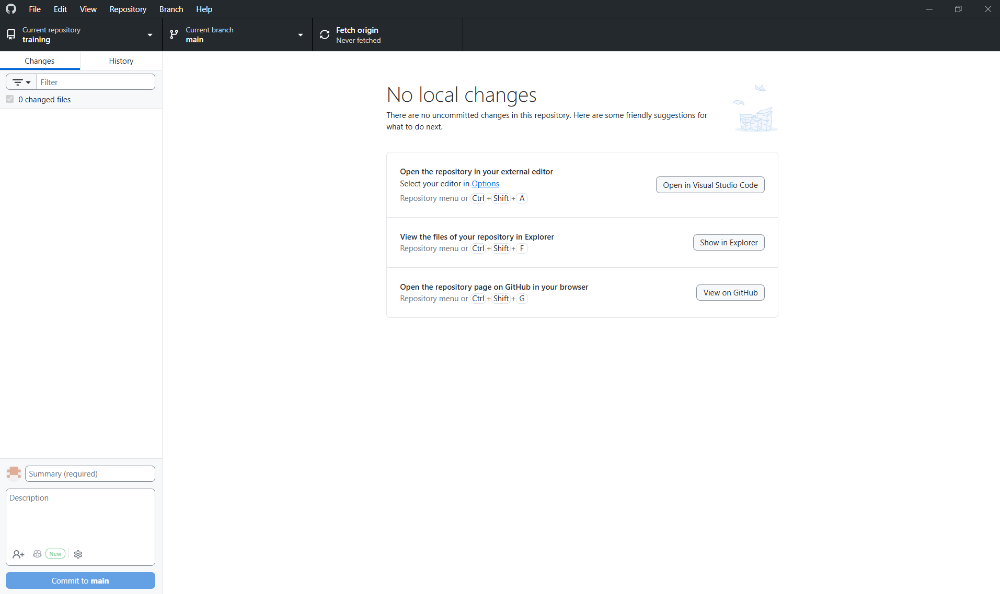{fig-alt="GitHub Desktop with the training repository open. Across the top bar: Current repository (training), Current branch (main), and Fetch origin. On the left, the Changes and History tabs, with 0 changed files, and Summary and Description boxes above a Commit to main button. The main area says No local changes and offers buttons to open the repository in an editor, show it in Explorer, or view it on GitHub."}

| Area | What it's for |
|---|---|
| **Current repository** (top left) | Switch between repos |
| **Current branch** | See and switch branches ([Lesson 6](06-branches-pull-requests.qmd)) |
| **Fetch / Pull / Push origin** (top) | Sync with GitHub. The label changes depending on what's needed |
| **Changes** tab | Files you've changed since the last commit |
| **History** tab | Past commits |
| **Summary / Description / Commit** (bottom left) | Save your changes as a commit |

The first time you open GitHub Desktop, it shows a **Let's get started!** screen with the same options as the File menu:

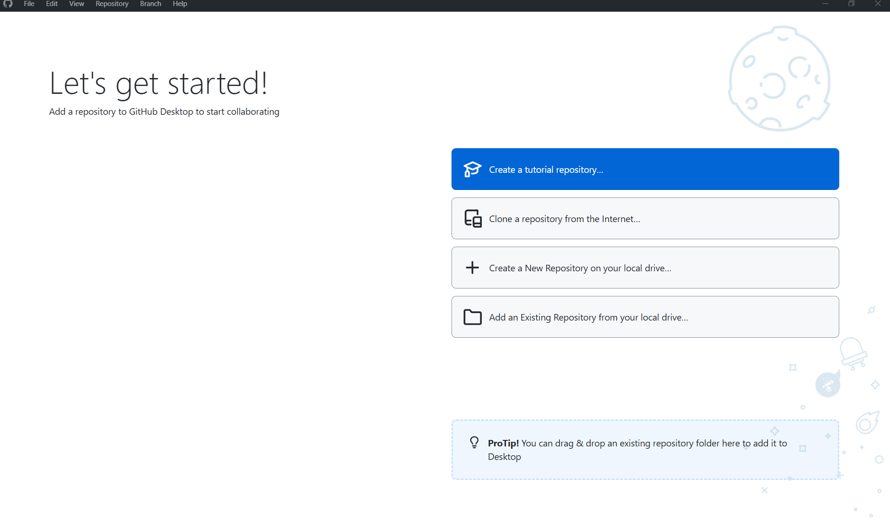{fig-alt="GitHub Desktop's Let's get started! screen with four buttons: Create a tutorial repository, Clone a repository from the Internet, Create a New Repository on your local drive, and Add an Existing Repository from your local drive."}

## Getting a repository onto your computer

| Situation | What to do |
|---|---|
| The repo is already on GitHub | **File → Clone repository**, choose it from the list (or paste the URL), choose where to save it, then click **Clone** |
| You have a local folder that isn't a repo yet | **File → Add local repository**, choose the folder, click **create a repository**, then **Publish repository** |
| You're starting from scratch | **File → New repository**, then **Publish repository** |

### Clone a repository

**File → Clone repository…** (**Ctrl + Shift + O**):

::: {.annotated style="max-width:45%"}
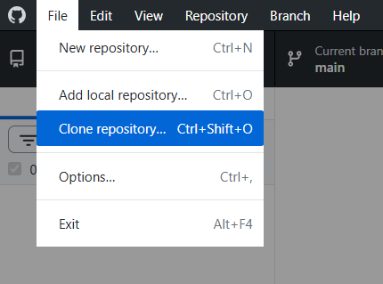{fig-alt="GitHub Desktop's File menu with Clone repository… (shortcut Ctrl+Shift+O) marked with a red box."}
[]{.red-box style="left:9.5%; top:39.5%; width:59%; height:11.5%;"}
:::

Choose the repo on the **GitHub.com** tab, or paste its URL on the **URL** tab. Check the **Local path** (e.g., `Documents\GitHub`), then click **Clone**.

::: {style="max-width:60%"}
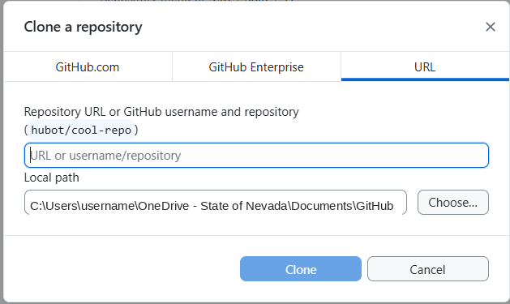{fig-alt="The Clone a repository dialog on the URL tab, with a box for the repository URL or username/repository, and a Local path ending in the Documents GitHub folder, with a Choose… button. Clone and Cancel buttons are at the bottom."}
:::

### Add a folder that's already on your computer

**File → Add local repository…** (**Ctrl + O**), then choose the folder:

::: {.annotated style="max-width:45%"}
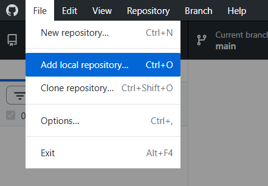{fig-alt="GitHub Desktop's File menu with Add local repository… (shortcut Ctrl+O) marked with a red box."}
[]{.red-box style="left:9.5%; top:29%; width:58%; height:12.5%;"}
:::

If the folder isn't a Git repository yet, GitHub Desktop says so. Click **create a repository**:

::: {.annotated style="max-width:55%"}
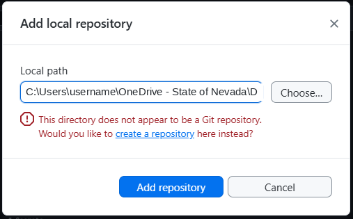{fig-alt="The Add local repository dialog with a local path filled in, and a red warning: This directory does not appear to be a Git repository. Would you like to create a repository here instead? The create a repository link is marked with a red box."}
[]{.red-box style="left:31.5%; top:56%; width:24%; height:8.5%;"}
:::

### Start a new repository

**File → New repository…** (**Ctrl + N**). Give it a name, choose the local path, and optionally add a README, `.gitignore`, and license:

::: {style="max-width:55%"}
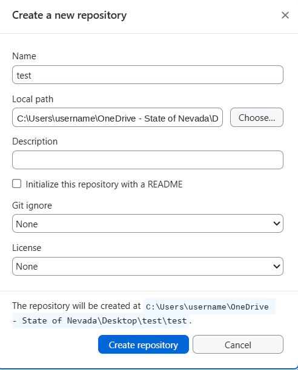{fig-alt="The Create a new repository dialog with Name (test), Local path, Description, an Initialize this repository with a README checkbox, Git ignore and License dropdowns, and a note showing where the repository will be created. A Create repository button is at the bottom."}
:::

### Publishing: choose the organization

A repository you create or add on your computer is **local only** until you publish it. GitHub Desktop lists it under **Other**, with a computer icon instead of a repo icon.

To put it on GitHub, click **Publish repository** in the top bar:

::: {.annotated}
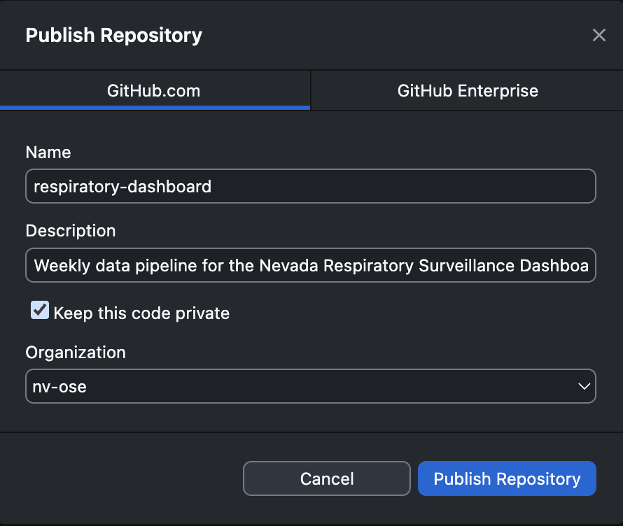{fig-alt="GitHub Desktop's Publish Repository dialog on the GitHub.com tab. The Name field says respiratory-dashboard, the Description field has a one-line summary, Keep this code private is checked, and the Organization dropdown is set to nv-ose. A red box marks the Organization dropdown and a green box marks the Keep this code private checkbox."}
[]{.green-box style="left:4%; top:56%; width:34%; height:6.5%;"}
[]{.red-box style="left:3.5%; top:69.5%; width:92.5%; height:8%;"}
:::

1. **Name:** lowercase with hyphens (see the [SOP naming rules](https://github.com/nv-ose/.github/blob/main/CONTRIBUTING.md#2-naming-conventions)).
2. **Description:** one sentence about what the repo is.
3. **Keep this code private** (green box): leave it checked unless an owner has approved making the repo public.
4. **Organization** (red box): choose **nv-ose** for team work.

::: {.callout-warning title="Check the Organization dropdown"}
It defaults to **None**, which publishes the repo to **your personal account**, not to NV OSE. It's an easy step to miss.
:::

::: {.callout-tip collapse="true" title="Published to the wrong account? How to move it"}
1. On github.com, open the repo and go to **Settings → Danger Zone → Transfer ownership**.
2. Choose **Specify an organization or username**, type **nv-ose**, and confirm by typing the repo name.
3. In GitHub Desktop, go to **Repository → Repository Settings → Remote** and change the URL to `https://github.com/nv-ose/<repo-name>.git`. Then click **Fetch origin** to check it works.

GitHub redirects the old address for a while, but update the remote anyway.
:::

## The everyday loop

### 1. Pull first

Click **Fetch origin**. If others made changes, the button changes to **Pull origin**, with a ↓ count of new commits. Click it.

::: {.annotated}
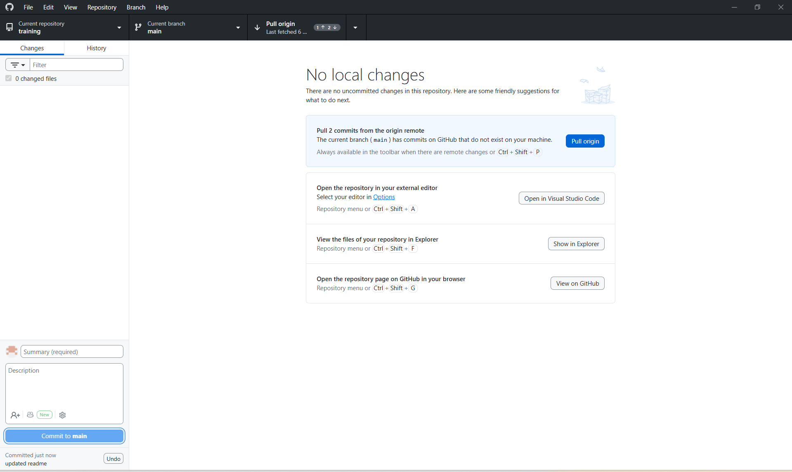{fig-alt="GitHub Desktop with no local changes. The top bar button reads Pull origin with a count of 2 down arrows, marked with a red box, and the main area says Pull 2 commits from the origin remote with a blue Pull origin button."}
[]{.red-box style="left:31.2%; top:3%; width:12.6%; height:5.6%;"}
:::

::: {.callout-tip}
Always pull before you start working. It avoids most conflicts.
:::

### 2. Make changes

Edit files in your usual tools, such as RStudio, VS Code, Excel or Word. GitHub Desktop notices automatically.

### 3. Review your changes

The **Changes** tab lists every file that changed. Click a file to see exactly what changed: **red** lines were removed, **green** lines were added.

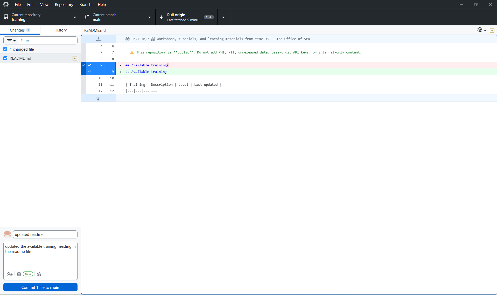{fig-alt="GitHub Desktop's Changes tab with one changed file, README.md. The diff on the right shows a red removed line, ## Available trainings, and a green added line, ## Available training. At the bottom left, the Summary says updated readme, the Description explains the change, and the button reads Commit 1 file to main."}

- **Uncheck** any file you don't want in this commit. Checked files are included:

::: {style="max-width:30%"}
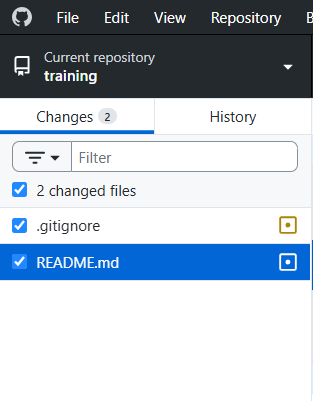{fig-alt="The Changes list with 2 changed files, .gitignore and README.md, both checked."}
:::

- **Check for sensitive content.** Is there a password, a real name, or a data file? If so, uncheck it, and add it to `.gitignore`: right-click the file → **Ignore file**.

::: {.columns}
::: {.column width="48%"}
::: {style="max-width:100%"}
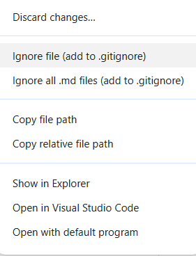{fig-alt="The right-click menu for a changed file, with Discard changes…, Ignore file (add to .gitignore), Ignore all .md files (add to .gitignore), Copy file path, Show in Explorer, and Open in Visual Studio Code."}
:::
:::
::: {.column width="4%"}
:::
::: {.column width="48%"}
Right-clicking a file gives you **Ignore file (add to .gitignore)** to keep it out of Git for good, and **Discard changes…** to throw away your edits to it ([below](#other-handy-features)).
:::
:::

### 4. Commit

1. Write a **Summary**, such as `Add age-group filter to flu script`.
2. Optional: add a **Description** with more detail.
3. Click **Commit to main**, or to whichever branch you're on.

::: {.annotated style="max-width:40%"}
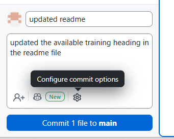{fig-alt="The bottom of GitHub Desktop's Changes tab: the Summary box says updated readme, the Description says updated the available training heading in the readme file, and the Commit 1 file to main button is marked with a red box."}
[]{.red-box style="left:2.5%; top:80.5%; width:87%; height:14%;"}
:::

A commit is saved **only on your computer** at this point.

### 5. Push

Click **Push origin**. The ↑ count shows how many commits are waiting. Your commits are now on GitHub.

::: {.annotated}
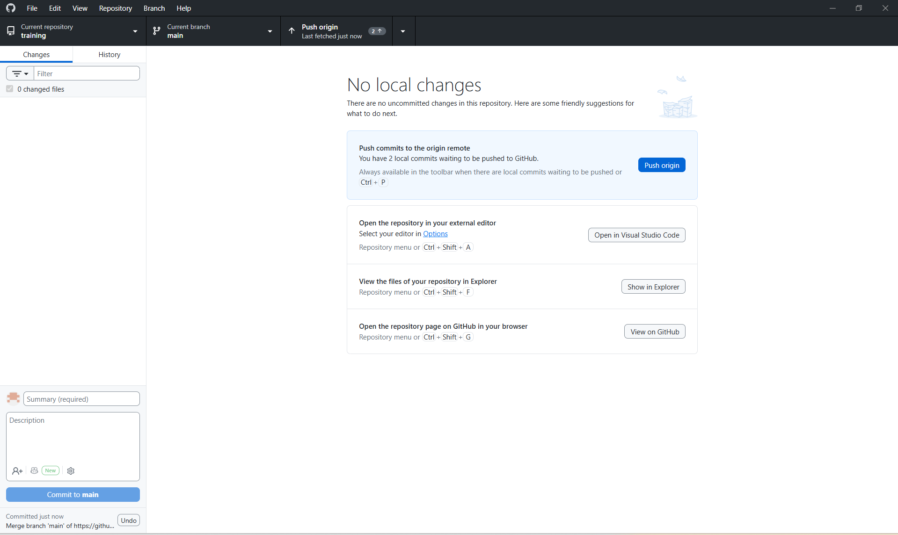{fig-alt="GitHub Desktop after committing. The top bar button reads Push origin with a count of 2 up arrows, marked with a red box, and the main area says You have 2 local commits waiting to be pushed to GitHub, with a blue Push origin button. At the bottom left, Committed just now with an Undo button."}
[]{.red-box style="left:31.2%; top:3%; width:12.6%; height:5.6%;"}
:::

::: {.callout-tip title="Changed your mind right after committing?"}
Before you push, click **Undo** at the bottom left (next to "Committed just now") to take the commit back. Your changes stay in the Changes tab.
:::

## Other handy features

| Feature | Where |
|---|---|
| See past commits | **History** tab |
| Undo the most recent commit (before pushing) | **History** → right-click the commit → **Undo commit** |
| Discard changes to a file | **Changes** → right-click the file → **Discard changes** |
| Reverse a commit you've already pushed | **History** → right-click → **Revert changes in commit**. This makes a new commit that undoes it |
| Open the repo in your editor or file browser | **Repository → Open in…** / **Show in Explorer** (Mac: Show in Finder) |
| View the repo on GitHub | **Repository → View on GitHub** |
| Branches and pull requests | See [Lesson 6](06-branches-pull-requests.qmd) |

### History

The **History** tab lists every commit, newest first. Click one to see which files it changed:

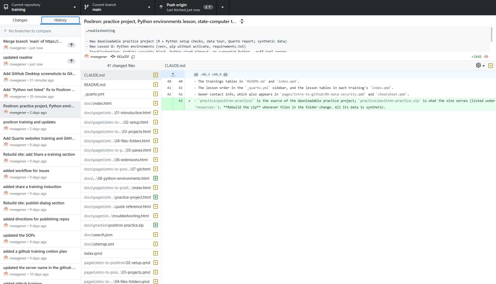{fig-alt="GitHub Desktop's History tab: a list of commits with their messages, authors, and times on the left (two marked with up arrows, meaning not pushed yet), and on the right the selected commit's message, its 41 changed files, and the diff of one file."}

Right-click a commit for more options:

::: {.annotated style="max-width:30%"}
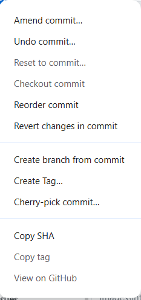{fig-alt="The right-click menu for a commit in the History tab, with Undo commit… marked with a red box and Revert changes in commit marked with a green box. Other items include Amend commit, Create branch from commit, Cherry-pick commit, and Copy SHA."}
[]{.red-box style="left:5%; top:10.5%; width:90%; height:7%;"}
[]{.green-box style="left:5%; top:38.5%; width:90%; height:7%;"}
:::

- **Undo commit** (red): for your **latest commit that isn't pushed yet**. The changes go back to the Changes tab.
- **Revert changes in commit** (green): for a commit that's **already pushed**. It makes a *new* commit that reverses it, so history stays intact.

### Discarding changes

Right-click a file in **Changes** → **Discard changes…**, then confirm:

::: {.columns}
::: {.column width="45%"}
::: {style="max-width:100%"}
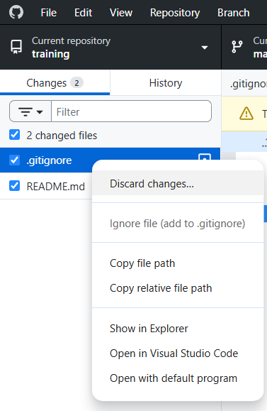{fig-alt="The Changes list with .gitignore selected and its right-click menu open, showing Discard changes… at the top."}
:::
:::
::: {.column width="5%"}
:::
::: {.column width="50%"}
::: {style="max-width:100%"}
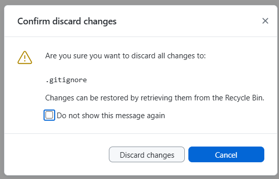{fig-alt="The Confirm discard changes dialog asking: Are you sure you want to discard all changes to .gitignore? Changes can be restored by retrieving them from the Recycle Bin. Discard changes and Cancel buttons are at the bottom."}
:::
:::
:::

To throw away **all** uncommitted changes at once (for example, after testing something), use **Branch → Discard all changes…** (**Ctrl + Shift + Backspace**):

::: {.columns}
::: {.column width="45%"}
::: {style="max-width:100%"}
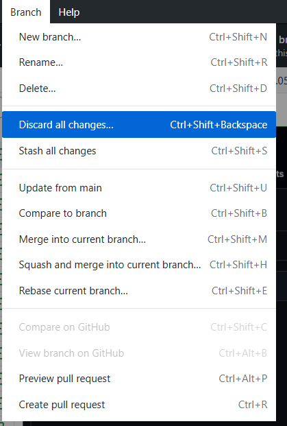{fig-alt="GitHub Desktop's Branch menu with Discard all changes… (shortcut Ctrl+Shift+Backspace) highlighted. Other items include New branch, Rename, Delete, Stash all changes, Update from main, Merge into current branch, Compare on GitHub, Preview pull request, and Create pull request."}
:::
:::
::: {.column width="5%"}
:::
::: {.column width="50%"}
::: {style="max-width:100%"}
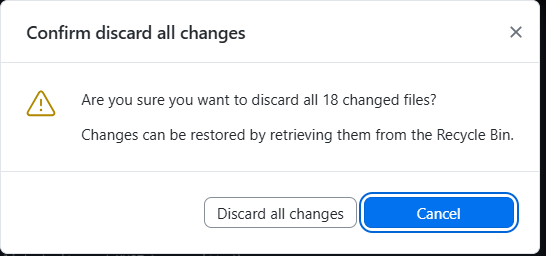{fig-alt="The Confirm discard all changes dialog asking: Are you sure you want to discard all 18 changed files? Changes can be restored by retrieving them from the Recycle Bin. Discard all changes and Cancel buttons are at the bottom."}
:::
:::
:::

::: {.callout-warning}
Discarding throws away your edits since the last commit. The file goes to the Recycle Bin, but don't rely on that. Only discard what you really don't want.
:::

## Writing good commit messages

- Start with a verb in the present tense: **Add**, **Fix**, **Update**, **Remove**.
- Say *what* changed and, if it isn't obvious, *why*.
- Keep the summary under about 50 characters.

| ✅ Good | ❌ Not helpful |
|---|---|
| `Fix date parsing in import script` | `fixed stuff` |
| `Add README for flu dashboard` | `update` |
| `Remove unused 2023 data columns` | `final version` |
