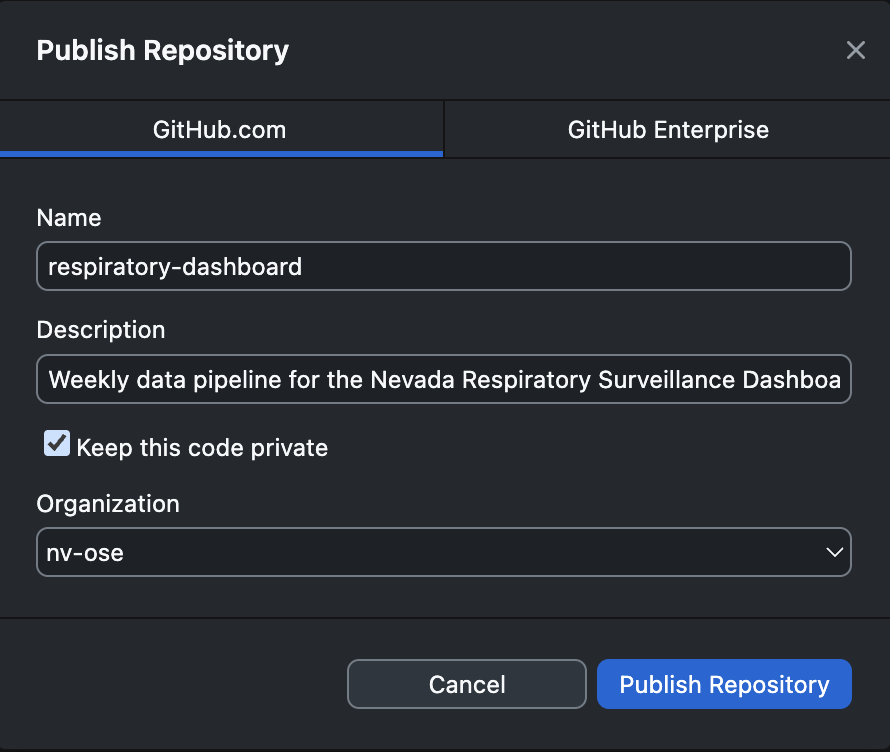

GitHub Desktop lets you do everyday Git work with buttons instead of commands. If you don't have it yet, [download GitHub Desktop](https://desktop.github.com/download/) and sign in (see [Lesson 2](02-setup.qmd#connect-github-desktop)). Behind the scenes, it runs the same Git commands you'll learn in [Lesson 5](05-command-line.qmd).

## The layout

```
┌──────────────────┬──────────────────┬──────────────────────────────┐
│ Current          │ Current branch ▾ │ Fetch / Pull / Push origin   │
│ repository ▾     │                  │                              │
├──────────────────┴──────────────────┴──────────────────────────────┤
│ Changes | History  │  Diff view: red = removed, green = added       │
│ ☑ file1.R          │                                                │
│ ☑ README.md        │                                                │
│                    │                                                │
│ Summary (required) │                                                │
│ Description        │                                                │
│ [Commit to main]   │                                                │
└────────────────────┴────────────────────────────────────────────────┘
```

## Getting a repository onto your computer

| Situation | What to do |
|---|---|
| The repo is already on GitHub | **File → Clone repository**, choose it from the list (or paste the URL), choose where to save it, then click **Clone** |
| You have a local folder that isn't a repo yet | **File → Add local repository**, choose the folder, click **create a repository**, then **Publish repository** |
| You're starting from scratch | **File → New repository**, then **Publish repository** |

### Publishing: choose the organization

A repository you create or add on your computer is **local only** until you publish it. GitHub Desktop lists it under **Other**, with a computer icon instead of a repo icon.

To put it on GitHub, click **Publish repository** in the top bar:

::: {.annotated}
{fig-alt="GitHub Desktop's Publish Repository dialog on the GitHub.com tab. The Name field says respiratory-dashboard, the Description field has a one-line summary, Keep this code private is checked, and the Organization dropdown is set to nv-ose. A red box marks the Organization dropdown and a green box marks the Keep this code private checkbox."}
[]{.green-box style="left:4%; top:56%; width:34%; height:6.5%;"}
[]{.red-box style="left:3.5%; top:69.5%; width:92.5%; height:8%;"}
:::

1. **Name:** lowercase with hyphens (see the [SOP naming rules](https://github.com/nv-ose/.github/blob/main/CONTRIBUTING.md#2-naming-conventions)).
2. **Description:** one sentence about what the repo is.
3. **Keep this code private** (green box): leave it checked unless an owner has approved making the repo public.
4. **Organization** (red box): choose **nv-ose** for team work.

::: {.callout-warning title="Check the Organization dropdown"}
It defaults to **None**, which publishes the repo to **your personal account**, not to NV OSE. It's an easy step to miss.
:::

::: {.callout-tip collapse="true" title="Published to the wrong account? How to move it"}
1. On github.com, open the repo and go to **Settings → Danger Zone → Transfer ownership**.
2. Choose **Specify an organization or username**, type **nv-ose**, and confirm by typing the repo name.
3. In GitHub Desktop, go to **Repository → Repository Settings → Remote** and change the URL to `https://github.com/nv-ose/<repo-name>.git`. Then click **Fetch origin** to check it works.

GitHub redirects the old address for a while, but update the remote anyway.
:::

## The everyday loop

### 1. Pull first

Click **Fetch origin**. If others made changes, the button changes to **Pull origin**. Click it.

::: {.callout-tip}
Always pull before you start working. It avoids most conflicts.
:::

### 2. Make changes

Edit files in your usual tools, such as RStudio, VS Code, Excel or Word. GitHub Desktop notices automatically.

### 3. Review your changes

The **Changes** tab lists every file that changed. Click a file to see exactly what changed.

- **Uncheck** any file you don't want in this commit.
- **Check for sensitive content.** Is there a password, a real name, or a data file? If so, uncheck it, and add it to `.gitignore`: right-click the file → **Ignore file**.

### 4. Commit

1. Write a **Summary**, such as `Add age-group filter to flu script`.
2. Optional: add a **Description** with more detail.
3. Click **Commit to main**, or to whichever branch you're on.

A commit is saved **only on your computer** at this point.

### 5. Push

Click **Push origin**. Your commits are now on GitHub.

## Other handy features

| Feature | Where |
|---|---|
| See past commits | **History** tab |
| Undo the most recent commit (before pushing) | **History** → right-click the commit → **Undo commit** |
| Discard changes to a file | **Changes** → right-click the file → **Discard changes** |
| Reverse a commit you've already pushed | **History** → right-click → **Revert changes in commit**. This makes a new commit that undoes it |
| Open the repo in your editor or file browser | **Repository → Open in…** / **Show in Finder (Explorer)** |
| View the repo on GitHub | **Repository → View on GitHub** |
| Branches and pull requests | See [Lesson 6](06-branches-pull-requests.qmd) |

## Writing good commit messages

- Start with a verb in the present tense: **Add**, **Fix**, **Update**, **Remove**.
- Say *what* changed and, if it isn't obvious, *why*.
- Keep the summary under about 50 characters.

| ✅ Good | ❌ Not helpful |
|---|---|
| `Fix date parsing in import script` | `fixed stuff` |
| `Add README for flu dashboard` | `update` |
| `Remove unused 2023 data columns` | `final version` |
