## What is a branch?

A **branch** is a separate copy of the project where you can make changes without affecting the main version. When the work is ready, you **merge** it back.

```
main:      A───B───────────E (merge)
                \         /
my-branch:       C───D───┘
```

- `main` is the official, working version.
- You create `my-branch`, make commits **C** and **D**, and `main` is unaffected.
- When you're done, you merge the branch back into `main`.

**Why use branches?** You can experiment safely, several people can work at once, and every change can be reviewed before it reaches `main`. The NV OSE SOP requires this for shared repos.

**Naming:** `yourname/short-description`, for example `mwegener/add-age-filter`.

## What is a pull request (PR)?

A **pull request** asks to merge your branch into `main`. It's where teammates:

- see exactly what changed
- leave comments on specific lines
- **approve** the change, or **request changes**
- merge it once it's approved

## The branch → PR → merge workflow

### In GitHub Desktop

This walkthrough uses a real (small) change to this training's README, from branch to merge.

**1. Create a branch.** Make sure you're on `main` and have pulled. Click **Current branch → New branch** (or **Branch → New branch…**, **Ctrl + Shift + N**):

::: {style="max-width:45%"}
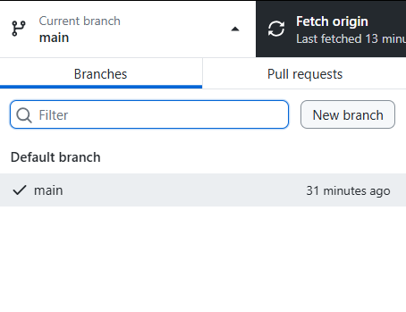{fig-alt="GitHub Desktop's Current branch dropdown opened, on the Branches tab, with a Filter box, a New branch button, and main listed as the default branch."}
:::

Name it `yourname/short-description`. It's based on the branch you're on (`main`). Click **Create branch**:

::: {style="max-width:50%"}
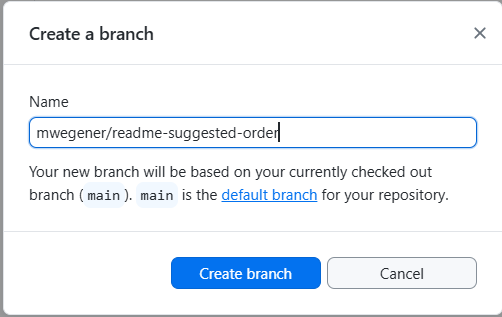{fig-alt="The Create a branch dialog with the name mwegener/readme-suggested-order typed in. A note says the new branch will be based on the currently checked out branch, main. Create branch and Cancel buttons are at the bottom."}
:::

**2. Make your changes and commit.** Edit and save as usual. The commit button now names your branch: **Commit to `yourname/…`**:

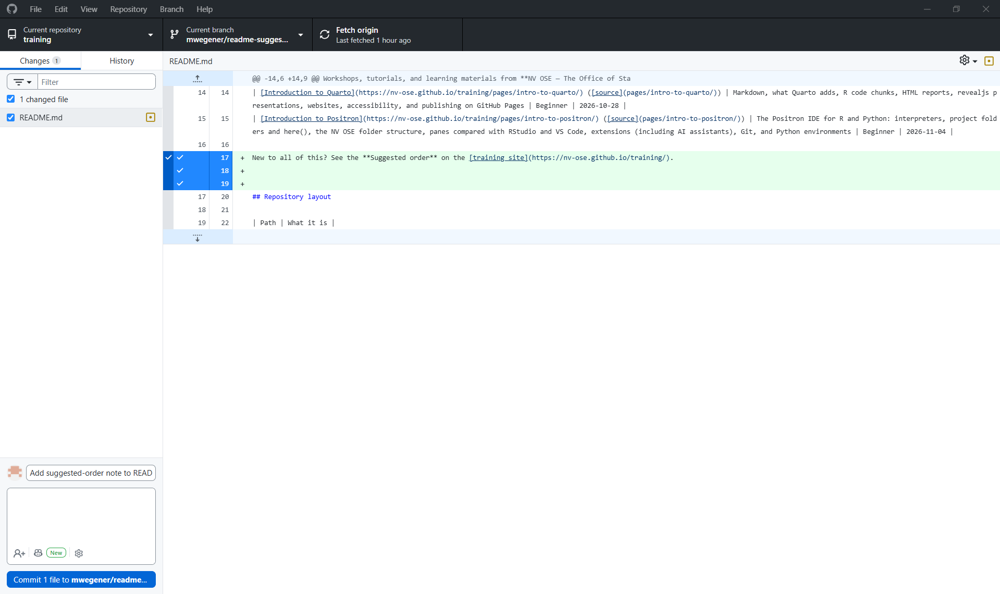{fig-alt="GitHub Desktop on the branch mwegener/readme-suggested-order with one changed file, README.md. The diff shows three added green lines, including a new note pointing to the Suggested order. The Summary reads Add suggested-order note to README, and the button reads Commit 1 file to mwegener/readme-suggested-order."}

**3. Publish the branch.** A new branch exists only on your computer until you publish it:

::: {style="max-width:70%"}
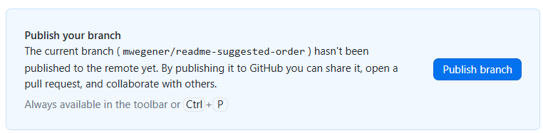{fig-alt="A GitHub Desktop prompt: Publish your branch. The current branch mwegener/readme-suggested-order hasn't been published to the remote yet. By publishing it to GitHub you can share it, open a pull request, and collaborate with others. A blue Publish branch button is on the right."}
:::

After that, push new commits on the branch with **Push origin**, as usual:

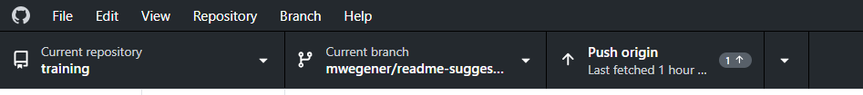{fig-alt="GitHub Desktop's top bar showing Current repository training, Current branch mwegener/readme-suggested-order, and Push origin with 1 commit waiting."}

**4. Preview and create the pull request.** Click **Preview Pull Request** (or **Branch → Create pull request**, **Ctrl + R**):

::: {style="max-width:70%"}
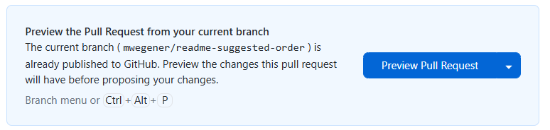{fig-alt="A GitHub Desktop prompt: Preview the Pull Request from your current branch. The branch is already published; preview the changes this pull request will have before proposing your changes. A blue Preview Pull Request button is on the right."}
:::

The preview shows exactly what will be in the pull request. Check it, then click **Create pull request**. Your browser opens on GitHub:

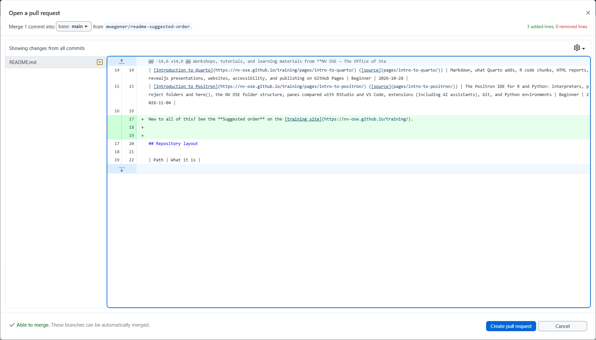{fig-alt="GitHub Desktop's Open a pull request preview, merging 1 commit into main from mwegener/readme-suggested-order. It shows README.md with the added lines in green, a note at the bottom saying Able to merge, and a Create pull request button."}

::: {.callout-tip title="Is the preview blank?"}
::: {style="max-width:60%"}
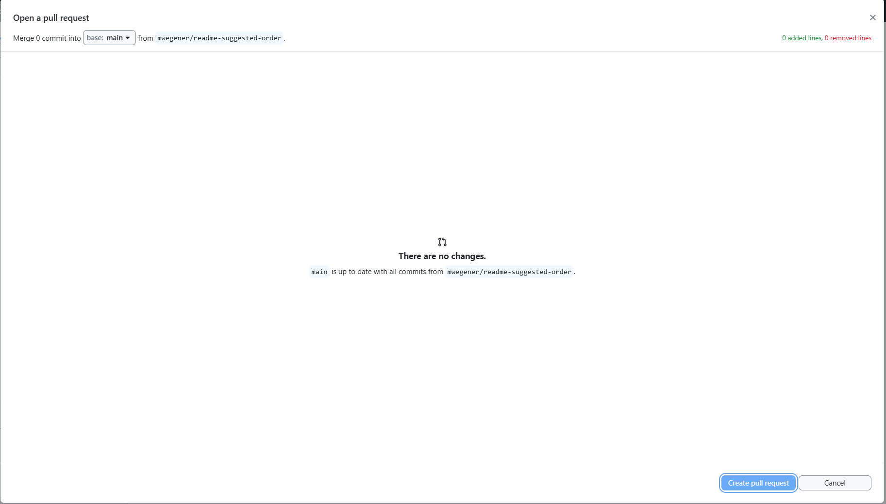{fig-alt="An empty pull request preview that says There are no changes. main is up to date with all commits from mwegener/readme-suggested-order."}
:::

Your changes aren't **committed on this branch** yet, so there's nothing to compare. Check the **History** tab: your commit should be at the top. If it isn't, commit (and push) on the branch, then preview again.
:::

**5. Fill in the pull request.** Add a clear **title** and a short **description** (what changed and why). On the right, click ⚙️ next to **Reviewers** and choose who should review:

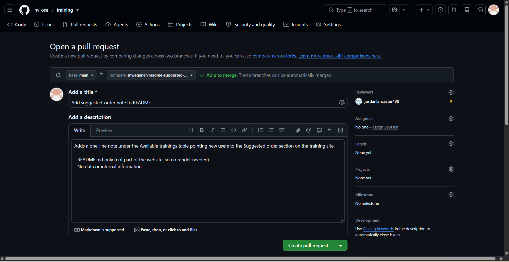{fig-alt="GitHub's Open a pull request page, comparing base main with mwegener/readme-suggested-order, marked Able to merge. The title is Add suggested-order note to README and the description explains the change in a sentence and two bullet points. On the right, Reviewers lists jordanlancaster430. A green Create pull request button is at the bottom."}

::: {style="max-width:40%"}
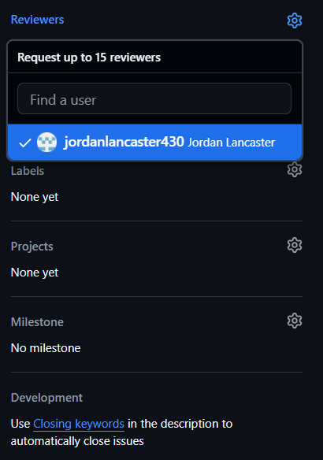{fig-alt="The Reviewers menu opened, titled Request up to 15 reviewers, with a Find a user box and jordanlancaster430 (Jordan Lancaster) selected with a checkmark."}
:::

Click **Create pull request**. The reviewer is notified.

**6. Merge after approval.** When the reviewer approves, the pull request shows it, along with the **Merge pull request** button:

::: {style="max-width:70%"}
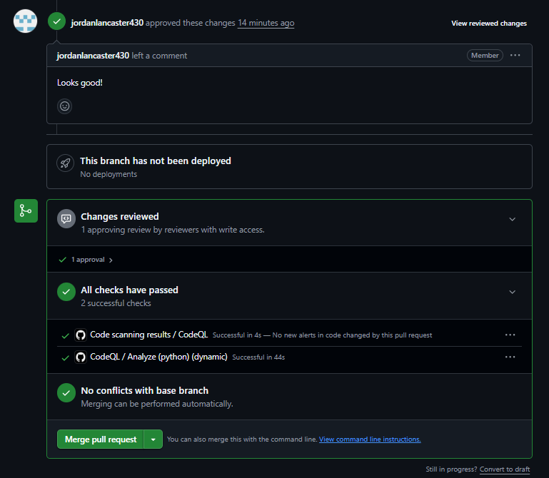{fig-alt="A pull request's Conversation tab: jordanlancaster430 approved these changes and left a comment, Looks good!. Below, Changes reviewed: 1 approving review, All checks have passed, No conflicts with base branch, and a green Merge pull request button."}
:::

Click **Merge pull request**, then **Confirm merge**:

::: {style="max-width:80%"}
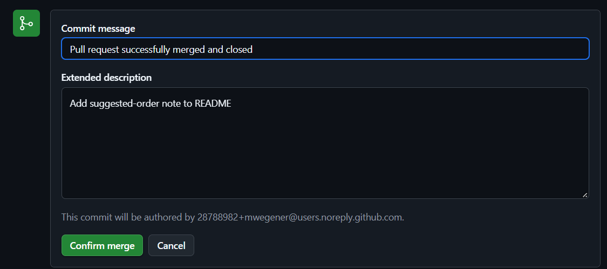{fig-alt="The Confirm merge form, with the commit message Pull request successfully merged and closed, an extended description, a note that the commit will be authored by a noreply address, and a green Confirm merge button."}
:::

Then click **Delete branch**. The branch's work is now in `main`, so the branch isn't needed anymore:

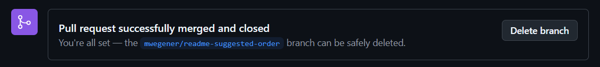{fig-alt="A banner on the merged pull request: Pull request successfully merged and closed. You're all set, the mwegener/readme-suggested-order branch can be safely deleted. A Delete branch button is on the right."}

**7. Back in GitHub Desktop,** switch to `main` and click **Pull origin** to get the merged change:

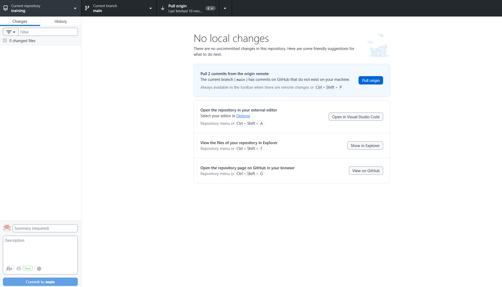{fig-alt="GitHub Desktop on the main branch with no local changes and a prompt to Pull 2 commits from the origin remote, with a blue Pull origin button."}

If GitHub Desktop offers to delete your local copy of the branch, say yes. Otherwise use **Branch → Delete…** while on another branch.

### On the command line

```bash
git switch main
git pull
git switch -c mwegener/add-age-filter      # Create and switch to a new branch
# ... edit, then:
git add .
git commit -m "Add age filter"
git push -u origin mwegener/add-age-filter
```

Then open the PR on github.com. GitHub shows a yellow **Compare & pull request** banner. After it's merged:

```bash
git switch main
git pull
git branch -d mwegener/add-age-filter      # Delete the local branch
```

Other branch commands:

```bash
git branch               # List local branches (* marks the current one)
git branch -a            # Include branches on GitHub
git switch branch-name   # Switch to an existing branch
```

## Reviewing a pull request

When you're asked to review, you'll get a notification and an email.

1. Open the PR and go to the **Files changed** tab. Added lines are green, removed lines red:

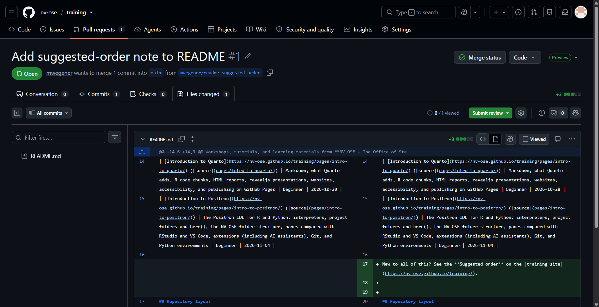{fig-alt="The Files changed tab of pull request #1, Add suggested-order note to README, showing README.md side by side: the old version on the left and the new version on the right, where lines 17 to 19 are added in green. A green Submit review button is at the top right."}

2. To comment on a specific line, hover over it and click the blue **+**. Type your comment, then **Start a review** (to send all your comments together) or **Comment** (to post just this one):

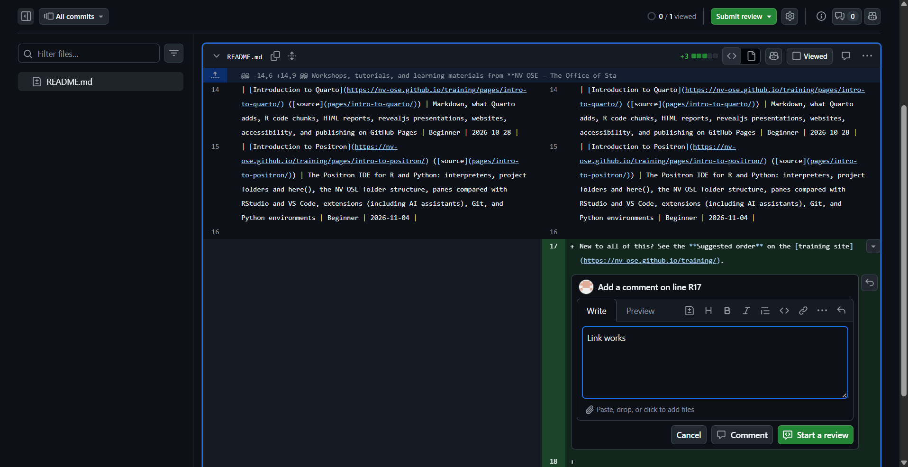{fig-alt="A line comment being written on line 17 of README.md in the Files changed tab: an Add a comment on line R17 box containing Link works, with Cancel, Comment, and Start a review buttons."}

3. Click **Submit review** (top right):

::: {style="max-width:45%"}
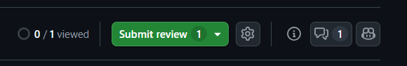{fig-alt="The top right of the Files changed tab: 0 of 1 files viewed, and a green Submit review button showing 1 pending comment."}
:::

4. Write a summary, choose **Comment**, **Approve**, or **Request changes**, and click **Submit review**:

::: {style="max-width:60%"}
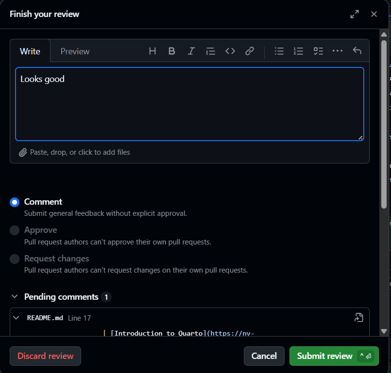{fig-alt="The Finish your review box with Looks good typed in, and three options: Comment (selected), Approve, and Request changes. Approve and Request changes note that pull request authors can't approve or request changes on their own pull requests. One pending comment is listed, with Cancel and Submit review buttons."}
:::

::: {.callout-note}
**You can't approve your own pull request.** As the author, you'll see Approve and Request changes greyed out. That's why you ask a teammate to review.
:::

When reviewing, ask: Does it work? Is it clear? **Is there any sensitive data or any credential in it?**

The **Conversation** tab shows the whole discussion: the description, review requests, comments, and approvals:

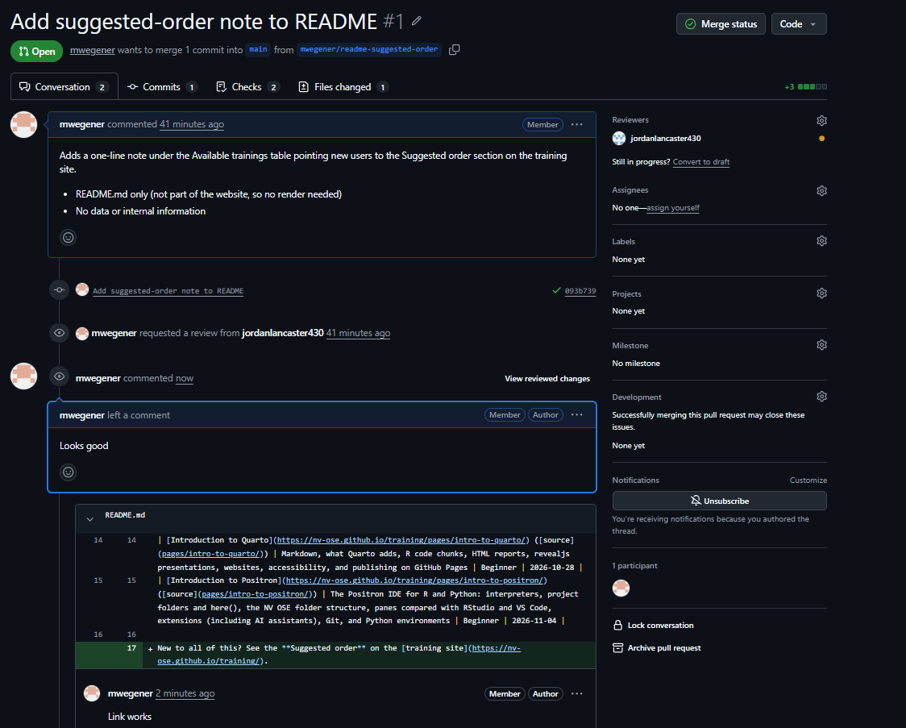{fig-alt="The Conversation tab of pull request #1: the author's description at the top, then a timeline showing a review requested from jordanlancaster430, a comment Looks good, and a line comment Link works on README.md. The right side lists Reviewers, Assignees, Labels, and other details."}

Until someone approves, the merge box shows **Review requested**. Merging is still possible, but in shared NV OSE repos, wait for the approval:

::: {style="max-width:70%"}
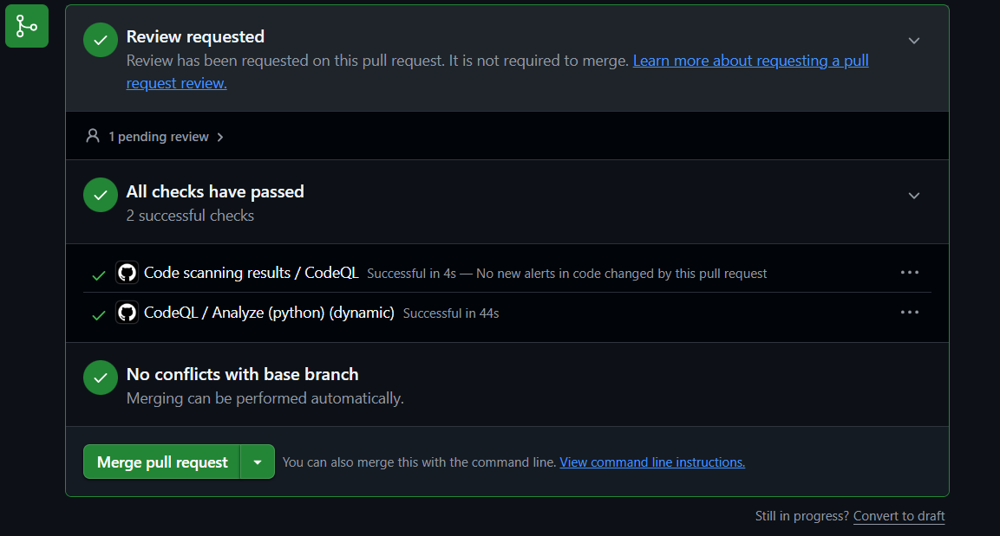{fig-alt="The merge box before approval: Review requested, 1 pending review; All checks have passed; No conflicts with base branch; and a green Merge pull request button."}
:::

## Merge conflicts

A **conflict** happens when two branches change the same lines of the same file. Git can't decide which version to keep, so it asks you.

The file will contain markers like this:

```
<<<<<<< HEAD
age_groups <- c("0-17", "18-64", "65+")
=======
age_groups <- c("0-4", "5-17", "18-49", "50-64", "65+")
>>>>>>> mwegener/add-age-filter
```

To resolve it:

1. Edit the file so it contains the version you want, and **delete all of the marker lines** (`<<<<<<<`, `=======`, `>>>>>>>`).
2. Save the file, then stage and commit it. GitHub Desktop walks you through this, and GitHub can resolve simple conflicts in the browser.

**To avoid conflicts:** pull often, keep branches short-lived, and talk with your team about who is editing what.
