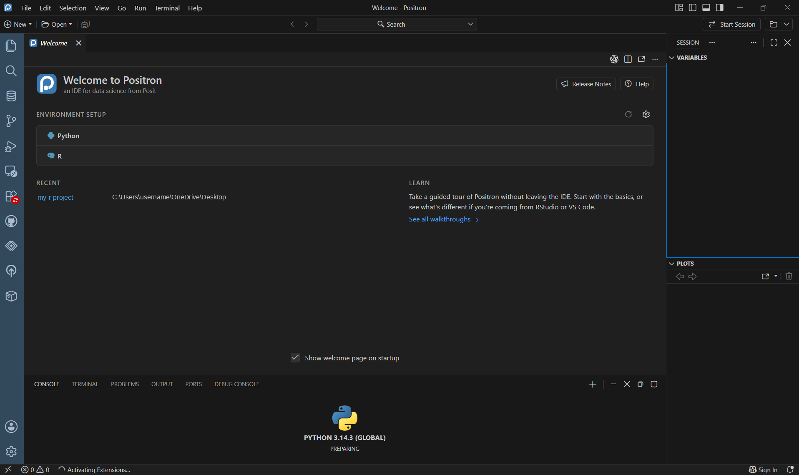

**Positron** is a free code editor (an **IDE**, integrated development environment) made by [Posit](https://posit.co/), the company behind RStudio. It's designed for **data science in both R and Python**.

{fig-alt="Positron's Welcome page in a dark theme. It shows 'Welcome to Positron, an IDE for data science from Posit', an Environment Setup section listing Python and R, a Recent list with one project, a Learn section linking to walkthroughs, and an empty Console at the bottom that is preparing Python."}

## Where it comes from

| | |
|---|---|
| **Made by** | Posit (formerly RStudio, PBC) |
| **Built on** | Code OSS, the open-source core of **VS Code** |
| **Languages** | R and Python built in; many others through extensions |
| **Cost** | Free |
| **Runs on** | Windows, Mac, and Linux |

Because it's built on VS Code, Positron *looks* like VS Code: the same menus, Command Palette, extensions, and Source Control. But it adds what data work needs, much of it familiar from RStudio:

- a **Console** for R or Python
- a **Variables** pane to see your data frames and objects
- a **Data Explorer** to browse, sort, and filter data
- **Plots**, **Help**, and **Viewer** panes
- built-in **Quarto** support, for reports, slides, and websites (see the [Introduction to Quarto](../intro-to-quarto/index.qmd) training)

## Why use it?

- **One tool for R and Python.** Switch languages, or use both, without changing editors.
- **Modern editor features:** multiple cursors, a powerful search, split editors, and thousands of extensions.
- **Familiar for RStudio users:** the Console, Variables, Plots, and Help panes work much like RStudio's.
- **Free and actively developed** by the team that makes RStudio.

::: {.callout-note title="Do I have to switch from RStudio?"}
No. RStudio is still supported, and everything in your R projects keeps working in both. Many people use Positron for new projects, or for anything that mixes R and Python.
:::

## What you'll do in this training

You'll build a small practice project, `my-r-project`, set up the NV OSE way:

```
my-r-project/
├── scripts/          # .R and .py files (code you run)
├── notebooks/        # .qmd and .md documents (code + text)
├── raw_data/         # original data, never edited (not in Git)
├── processed_data/   # cleaned data (not in Git)
├── images/           # figures and screenshots
├── reports/          # rendered output (HTML, Word, PDF)
├── downloads/        # files from outside sources (not in Git)
├── README.md         # what this project is and how to use it
├── .gitignore        # files Git should never track
└── .here             # marks the project's top folder for here::here()
```

All data in the examples is made up.
