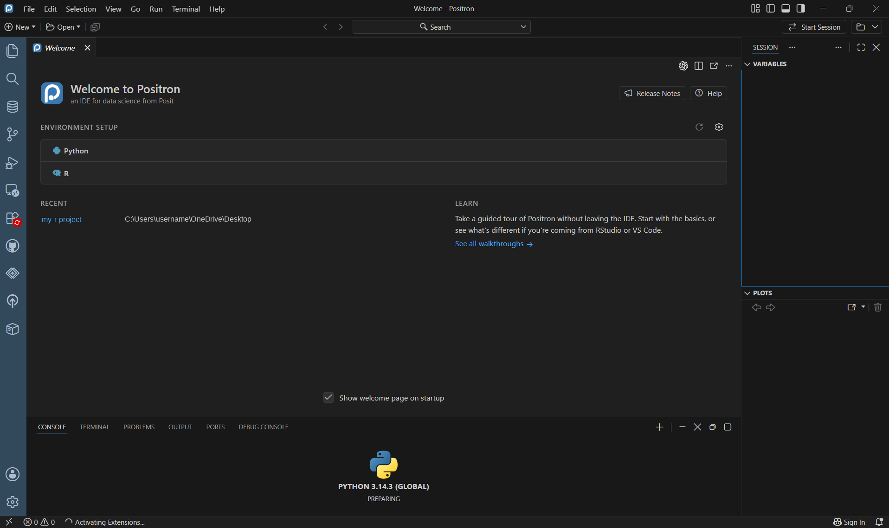
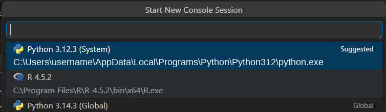
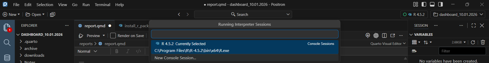

## 1. Install R and/or Python first

Positron **doesn't install R or Python itself**. It finds and uses the versions already on your computer, so install them first:

| Language | Where to get it | Notes |
|---|---|---|
| **R** | [cran.r-project.org](https://cran.r-project.org/) | Accept the defaults |
| **Python** | [python.org/downloads](https://www.python.org/downloads/) | On Windows, check **"Add python.exe to PATH"** during setup |

::: {.callout-warning title="Windows: avoid the Microsoft Store Python"}
Windows may include a "Python" shortcut that just opens the Microsoft Store. It often doesn't work with Positron. Install Python from [python.org](https://www.python.org/downloads/) instead.
:::

On a state computer, you may need IT to install software. Request it ahead of time.

## 2. Install Positron

1. Download it from [positron.posit.co](https://positron.posit.co/).
2. Run the installer and open Positron.
3. If you already use VS Code: Positron is a **separate app**, so your VS Code extensions and settings don't carry over (see [Lesson 6](06-extensions.qmd)).

## 3. Start R or Python: the interpreter picker

There are **no R or Python icons in the left sidebar**. You start a language from the **interpreter picker** in the **top-right corner** of the window. It shows a language name, or **Start Session** if nothing is running yet.

::: {.annotated}
{fig-alt="Positron's window on first launch. A red box marks the Start Session button in the top-right corner, which is the interpreter picker."}
[]{.red-box style="left:87.6%; top:3.6%; width:7.6%; height:3%;"}
:::

1. Click the interpreter picker.
2. Choose an R or Python version. Each one shows where it's installed:

{fig-alt="The Start New Console Session list, showing three interpreters with their install locations: Python 3.12.3 (System, marked Suggested) in the user AppData folder, R 4.5.2 in Program Files, and Python 3.14.3 (Global)." width="80%"}

3. The **Console** at the bottom starts that language. The first start can take 10–30 seconds.

If Positron asks to install **`ipykernel`** for Python, say yes. Positron needs it to run Python.

### Starting another console

- **Top-right picker:** click it to see your running sessions, then choose **New Console Session…** to start another one.

::: {.annotated}
{fig-alt="The Running Interpreter Sessions list opened from the top-right picker. It shows R 4.5.2 as Currently Selected, and a New Console Session option below it, marked with a red box."}
[]{.red-box style="left:30.8%; top:84%; width:38.6%; height:13%;"}
:::

- **Console panel:** click the **+** (new session) button at the top of the Console, or the dropdown arrow beside it, and choose R or Python.
- **Command Palette** (**Ctrl + Shift + P**): type `Interpreter: Start New Session` (or `Python: New Console`).

To **restart** the current console instead, click the **↻** button at the top of the Console panel.

## 4. Where to run code

| Where | How | Example |
|---|---|---|
| **Console** (bottom panel) | Type code directly in the running language and press **Enter** | `print("hello")` |
| **Script file** | **File → New File → R File** or **Python File**. Put the cursor on a line and press **Ctrl + Enter**, or click **▶** at the top right of the file to run it all | `print("hello")` |
| **Terminal** (tab next to the Console) | A command line, not R or Python. Type `python` (or `R`) first to start one, then your code. Type `exit()` (Python) or `q()` (R) to leave | `python` then `print("hello")` |

::: {.callout-tip title="Typed `python` in the Console and got an error?"}
The Console is **already running Python**, so typing `python` makes it look for a variable called `python`. Just type the code itself, like `print("hello")`. Only the **Terminal** needs `python` first.
:::

## 5. Dark mode and themes

1. Press **Ctrl + K**, release, then **Ctrl + T** (Mac: **Cmd + K**, then **Cmd + T**).
2. Choose a dark theme (e.g., **Positron Dark**) from the list. Use the arrow keys to preview.

Other ways to get there:

- **Windows:** File → Preferences → Theme → Color Theme
- **Mac:** Positron → Settings → Theme → Color Theme
- **Command Palette:** type `Color Theme`

To follow your computer's light/dark setting automatically: open **Settings**, search for `auto detect color scheme`, and turn on **Window: Auto Detect Color Scheme**.
