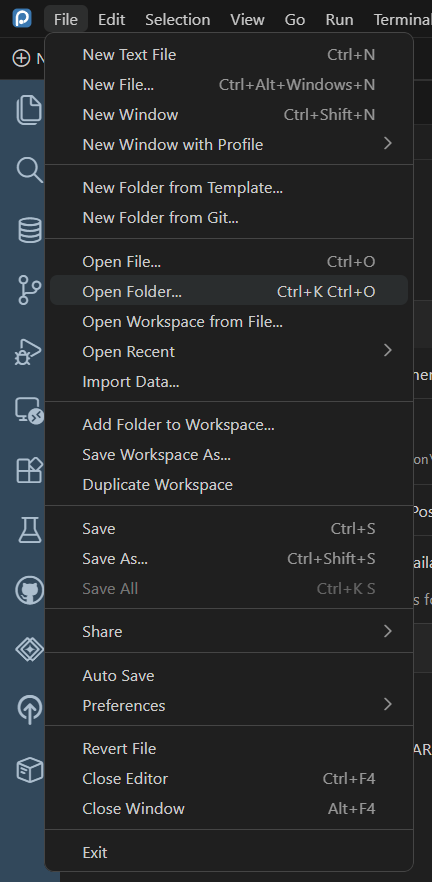
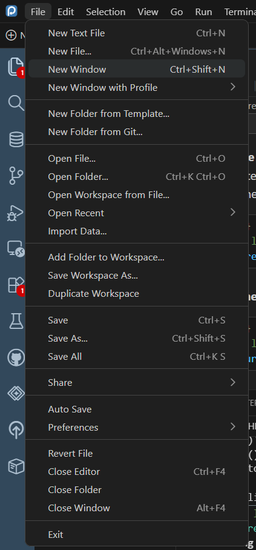
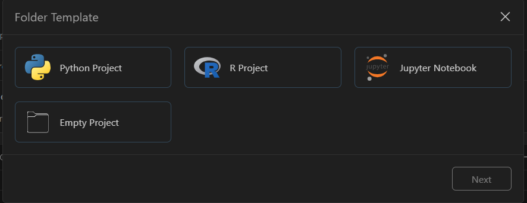
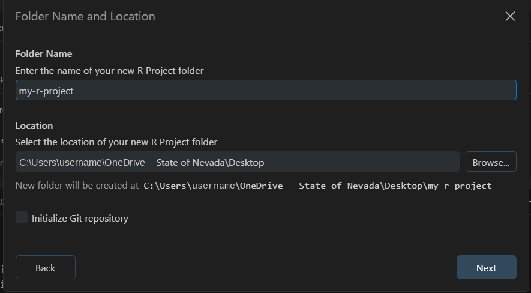
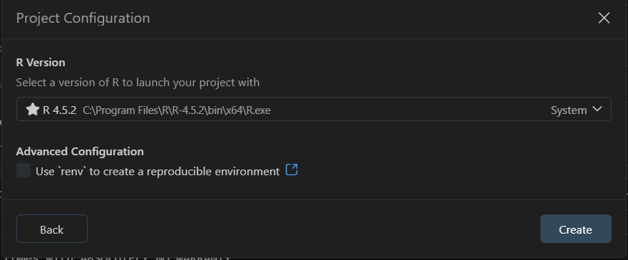
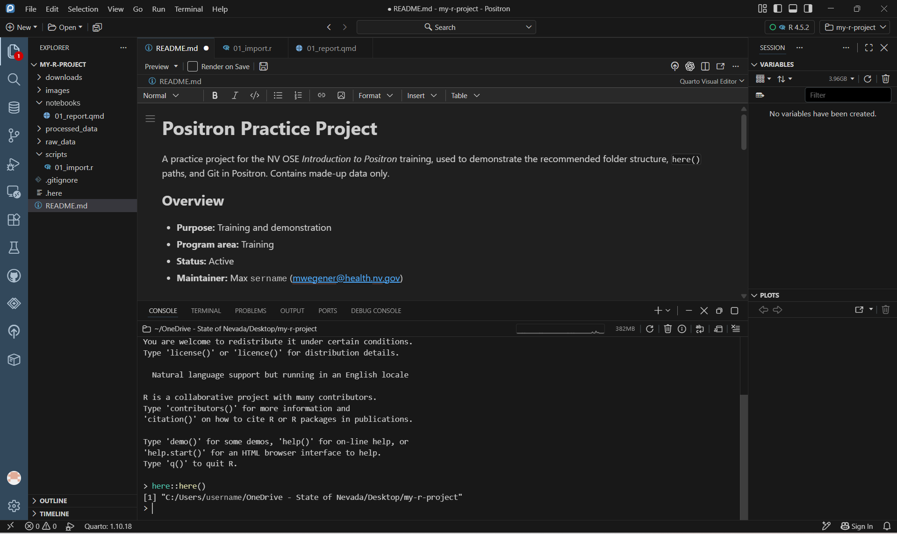

## In Positron, a project is a folder

In **RStudio**, a project is defined by an `.Rproj` file: you open the file, and RStudio sets up the project.

In **Positron** (as in VS Code), a project is simply a **folder**. You open the folder, and everything inside it is your project: the Explorer shows its files, the Console starts in it, and Git works on it.

| | RStudio | Positron |
|---|---|---|
| What defines a project | An `.Rproj` file | The folder you open |
| Open a project | Double-click the `.Rproj` file, or **File → Open Project** | **File → Open Folder…** |
| Working directory | The `.Rproj` file's folder | The opened folder |
| Switch projects | Project menu (top right) | Folder menu (top right), or **File → Open Recent** |

::: {.callout-tip title="Already have an .Rproj file?"}
Keep it. Positron just opens the folder it's in, and colleagues using RStudio can still use the `.Rproj` file. You don't need to create one for Positron.
:::

## Opening a folder

**File → Open Folder…** (or **Ctrl + K**, then **Ctrl + O**), then choose your project folder.

::: {.annotated style="max-width:45%"}
{fig-alt="Positron's File menu opened, with Open Folder… (shortcut Ctrl+K Ctrl+O) marked with a red box. Other items include New Text File, New File, New Window, New Folder from Template, Open File, Open Recent, Save, and Close Window."}
[]{.red-box style="left:10.5%; top:31.5%; width:84%; height:4%;"}
:::

::: {.callout-warning}
Open your **project** folder, not the folder where R or Python is installed. To choose which R or Python to use, use the **interpreter picker** ([Lesson 2](02-setup.qmd#start-r-or-python-the-interpreter-picker)).
:::

The folder's name then appears at the top of the Explorer and in the **folder menu** at the top right, next to the interpreter picker. Use that menu to switch between recent projects.

### Working on two projects at once

Use **File → New Window** (**Ctrl + Shift + N**), then open the other folder in the new window. Each window is its own project, with its own Console and files.

::: {.annotated style="max-width:45%"}
{fig-alt="Positron's File menu with New Window (shortcut Ctrl+Shift+N) marked with a red box."}
[]{.red-box style="left:10%; top:11%; width:86%; height:4%;"}
:::

## Creating a new project from a template

Positron can create a new project folder for you: **File → New Folder from Template…**

{fig-alt="The Folder Template dialog with four choices: Python Project, R Project, Jupyter Notebook, and Empty Project." width="70%"}

1. Choose **R Project** (or Python Project), and click **Next**.
2. Enter a **Folder Name** (lowercase, hyphens: `my-r-project`) and choose its **Location**, such as your `Documents\GitHub` folder.

   {fig-alt="The Folder Name and Location step. The folder name is my-r-project, the location is a Desktop folder, a line below shows the full path where the new folder will be created, and there is an unchecked Initialize Git repository box." width="70%"}

   Leave **Initialize Git repository** unchecked for now. You'll set up Git in [Lesson 7](07-git.qmd), after adding a `.gitignore`.
3. Choose the **R version**, and leave **Use renv** unchecked unless you already use `renv`. Click **Create**.

   {fig-alt="The Project Configuration step. R 4.5.2 is selected as the R version, and an Advanced Configuration checkbox 'Use renv to create a reproducible environment' is unchecked. A Create button is at the bottom right." width="70%"}

Positron creates the folder and opens it.

::: {.callout-important title="Where to keep projects, and where to keep data"}
Keep the **code** separate from any **sensitive data**:

- **Project folder (code):** in `Documents\GitHub\` on your computer (or `Documents\GitHub\NV-OSE\` for NV OSE repos). Scripts, notebooks, and the README contain no PHI, and Git works best on a local drive. Avoid network drives for Git projects.
- **PHI/PII data:** stays on the **approved network drive**. Never copy it to your computer. Your scripts read it from there, using a path saved in your personal `.Renviron` file.

See [Where the data lives](../intro-to-github/project-setup.qmd#where-the-data-lives) for how to set this up.
:::

## The `.here` file and `here::here()`

Scripts need file paths, like `raw_data/cases.csv`. Typing full paths (`C:\Users\...`) breaks as soon as someone else runs your code, or the folder moves. The **`here`** package fixes this by building every path from the project's top folder:

```r
library(here)
cases <- read.csv(here("raw_data", "cases.csv"))
```

`here()` finds the top folder by looking for a marker file. An empty file called **`.here`** is the clearest marker. Create one once per project. In the Console, with your project open:

```r
install.packages("here")   # first time only
here::set_here()           # creates an empty .here file in the current folder
```

Or create it in the Explorer: a new file named `.here` ([Lesson 4](04-files-folders.qmd)).

Check it works:

```r
here::here()
```

{fig-alt="Positron with my-r-project open. The README is in the editor, and the Console at the bottom shows here::here() returning the project folder's full path, ending in my-r-project."}

`here()` returns your project's top folder. From now on, `here("raw_data", "cases.csv")` works for anyone, wherever the folder is saved.

::: {.callout-tip}
`here()` also recognizes an `.Rproj` file or a `.git` folder as the top of a project, but a `.here` file is the most reliable, and it works the same in Positron, RStudio, and VS Code.
:::
