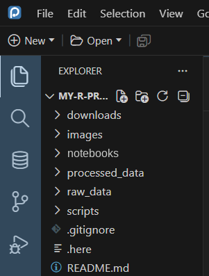
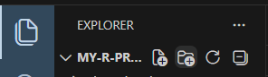
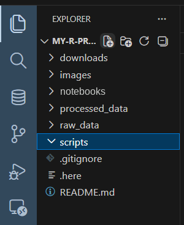
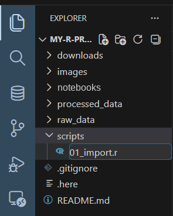
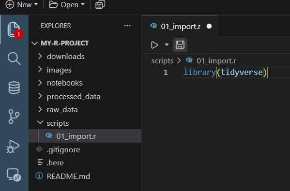
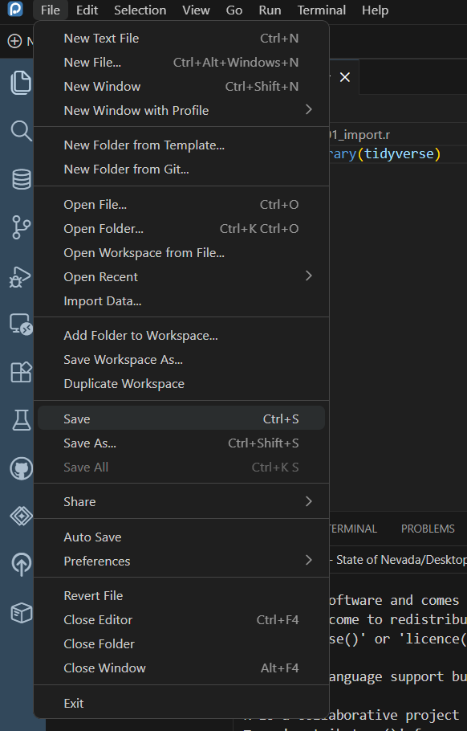
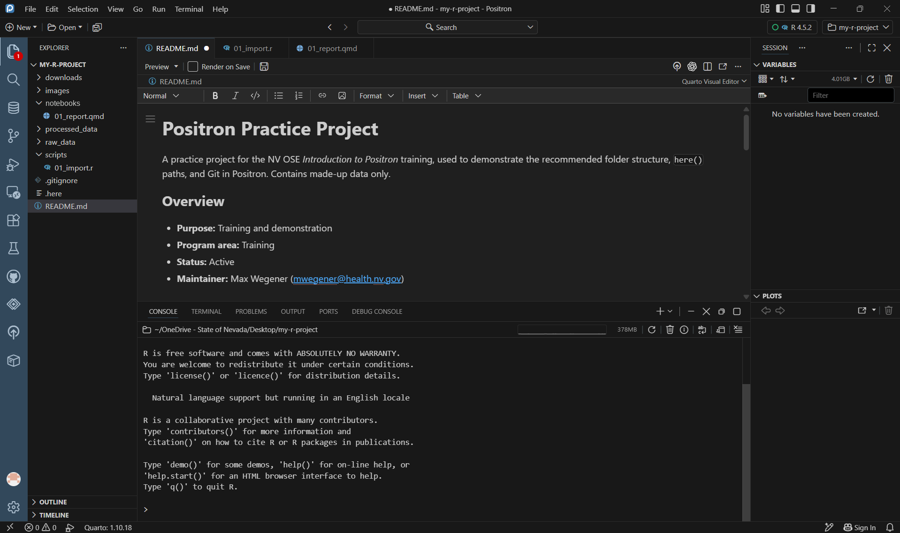
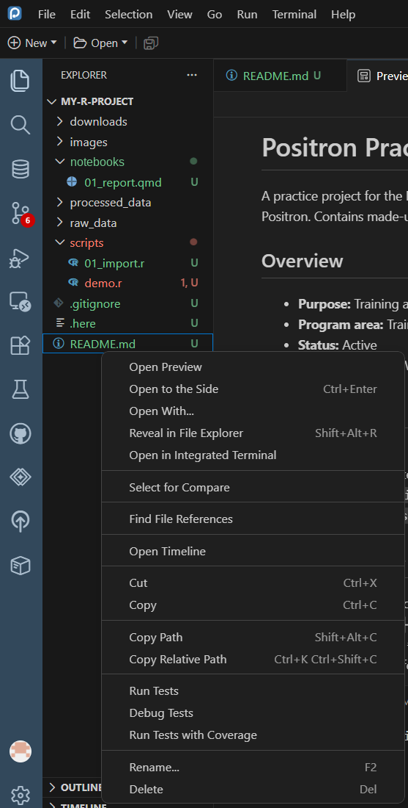
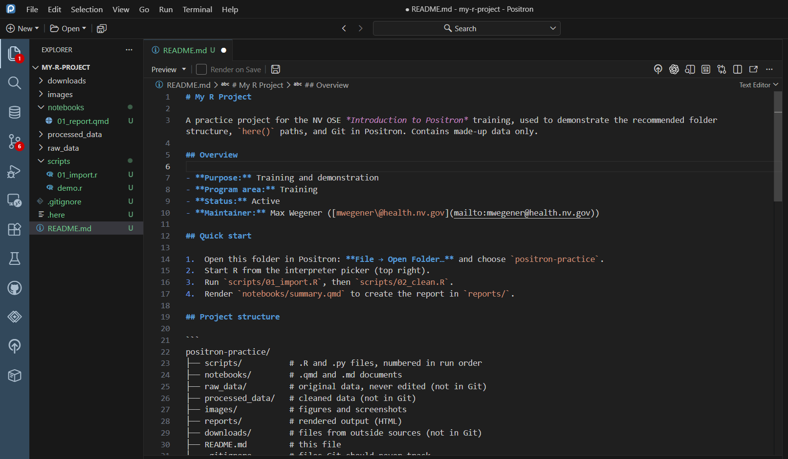
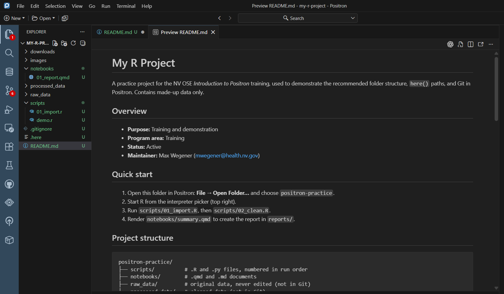

## The Explorer

The **Explorer** (top icon in the left bar, or **Ctrl + Shift + E**) shows every file and folder in your project.

{fig-alt="The Explorer for MY-R-PROJECT, listing the folders downloads, images, notebooks, processed_data, raw_data, and scripts, followed by the files .gitignore, .here, and README.md." width="40%"}

## The NV OSE folder structure

Use the same folders in every project, so anyone can find their way around:

| Folder or file | What goes in it | In Git? |
|---|---|---|
| `scripts/` | `.R` and `.py` files: code you run. Number them in order: `01_import.R`, `02_clean.R` | ✅ |
| `notebooks/` | `.qmd`, `.Rmd`, and `.md` files: documents that mix code and text | ✅ |
| `raw_data/` | Original data, **never edited** | ❌ |
| `processed_data/` | Cleaned or derived data, created by your scripts | ❌ |
| `images/` | Figures and screenshots | ✅ (if no data shown) |
| `reports/` | Rendered output: HTML, Word, PDF | Usually ❌ |
| `downloads/` | Files pulled from outside sources | ❌ |
| `README.md` | What the project is and how to use it ([guide](../intro-to-github/readme-guide.qmd)) | ✅ |
| `.gitignore` | Files and folders Git should never track | ✅ |
| `.here` | Marks the top of the project for `here()` ([Lesson 3](03-projects.qmd#the-.here-file-and-herehere)) | ✅ |

Delete folders you don't need. Data folders stay **out of Git** with a `.gitignore` ([Lesson 7](07-git.qmd)).

## Creating folders

Hover over the project name at the top of the Explorer to see four icons: **New File**, **New Folder**, **Refresh**, and **Collapse All**.

::: {.annotated style="max-width:45%"}
{fig-alt="The top of the Explorer for MY-R-PROJECT, with four icons beside the name: New File, New Folder (marked with a red box), Refresh, and Collapse All."}
[]{.red-circle style="left:64%; top:52%; width:12%; height:42%;"}
:::

1. Click the folder you want the new folder **inside** (or click empty space to put it at the top level).
2. Click **New Folder**.
3. Type the name, e.g., `raw_data`, and press **Enter**.

## Creating files

1. **Click the folder** the file belongs in. For a script, click `scripts`.
2. Click **New File**.

   ::: {.annotated style="max-width:45%"}
   {fig-alt="The Explorer with the scripts folder selected, and the New File icon at the top of the Explorer marked with a red circle."}
   []{.red-circle style="left:54%; top:13%; width:11%; height:9%;"}
   :::

3. Type the name **with its extension** and press **Enter**. The extension tells Positron what kind of file it is:

   ::: {.annotated style="max-width:45%"}
   {fig-alt="A new file being named 01_import.r inside the scripts folder in the Explorer, with the name box marked with a red box."}
   []{.red-box style="left:37%; top:64%; width:62%; height:10%;"}
   :::

| Extension | File type |
|---|---|
| `.R` | R script |
| `.py` | Python script |
| `.qmd` | Quarto document ([Quarto training](../intro-to-quarto/index.qmd)) |
| `.md` | Markdown (e.g., `README.md`) |
| `.csv` | Data (keep it in a data folder, out of Git) |

The new file opens in the editor, ready to type in.

::: {.callout-tip}
You can also create a file *and* folder at once: type `scripts/01_import.R` in the New File box, and Positron creates `scripts/` if it doesn't exist.
:::

Other ways to make a new file: **File → New File…** (choose R File, Python File, Quarto Document, and more), or the **New** button at the top left. These open an *untitled* file; you choose its name and folder when you save.

## Saving

An unsaved file shows a **dot** (●) on its tab instead of an ×.

::: {.annotated style="max-width:60%"}
{fig-alt="The editor with 01_import.r open, containing library(tidyverse). The file's tab shows a white dot, marked with a red circle, meaning it has unsaved changes."}
[]{.red-circle style="left:69.5%; top:10%; width:5%; height:9%;"}
:::

Save with **Ctrl + S**, or **File → Save**.

::: {.annotated style="max-width:45%"}
{fig-alt="The File menu with Save (shortcut Ctrl+S) marked with a red box."}
[]{.red-box style="left:8%; top:55.3%; width:62%; height:3.6%;"}
:::

::: {.callout-tip title="Turn on Auto Save"}
**File → Auto Save** saves files automatically as you work, so you never lose changes.
:::

## Editor tabs

Each open file gets a **tab** across the top of the editor. Click a tab to switch files; drag it to the side to view two files at once (or click **Split Editor** at the top right).

{fig-alt="Positron with my-r-project open. Three files are open as tabs across the top of the editor: README.md, 01_import.r, and 01_report.qmd. README.md is shown in the editor, and the Explorer on the left shows the project's folders and files."}

## Previewing a README

Markdown files like `README.md` open as text. To see them formatted:

1. Right-click `README.md` in the Explorer → **Open Preview** (or open the file and press **Ctrl + Shift + V**).

   ::: {.annotated style="max-width:55%"}
   {fig-alt="The right-click menu for README.md in the Explorer, with Open Preview at the top marked with a red box. Other options include Open to the Side, Reveal in File Explorer, Copy Path, Rename, and Delete."}
   []{.red-box style="left:24.5%; top:44%; width:74%; height:3.2%;"}
   :::

2. The preview opens in a new tab:

{fig-alt="README.md open as text in the editor, showing Markdown: a '# My R Project' heading, an Overview section with bold labels, a numbered Quick start, and a Project structure section with a folder tree inside a code block."}

{fig-alt="The same README shown as a formatted preview in a 'Preview README.md' tab: a large My R Project title, Overview bullets, a numbered Quick start, and the Project structure folder tree in a gray code box."}

For what to write in a README, see [Writing a good README](../intro-to-github/readme-guide.qmd).
