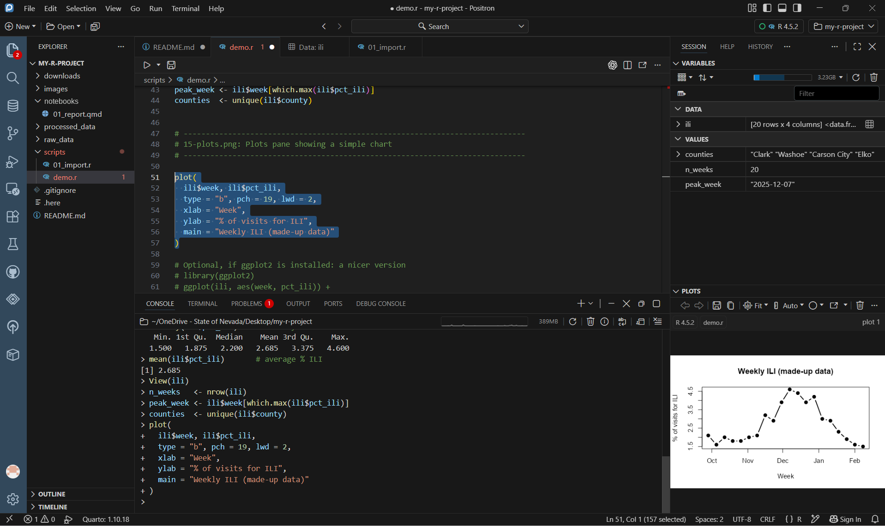
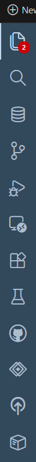
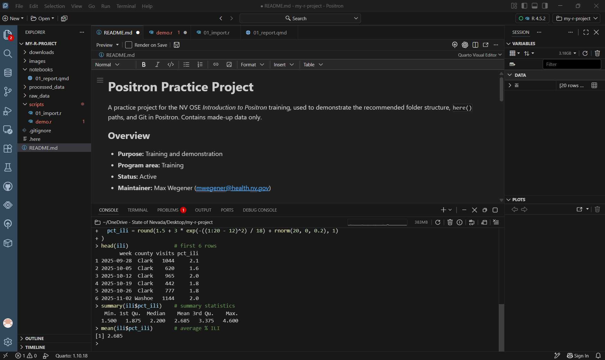
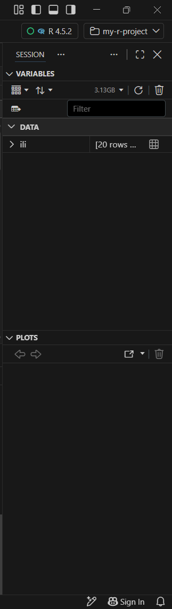
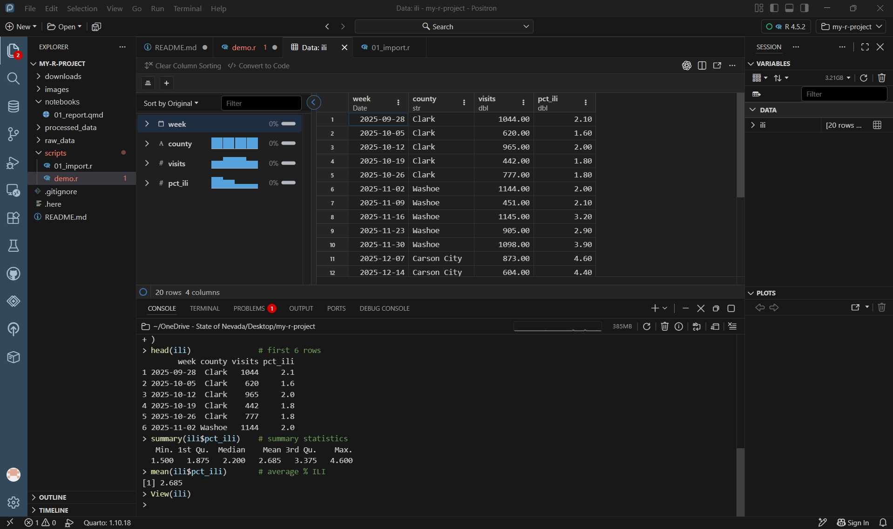
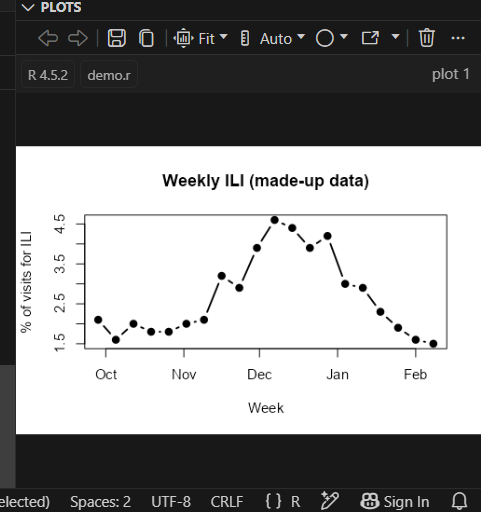
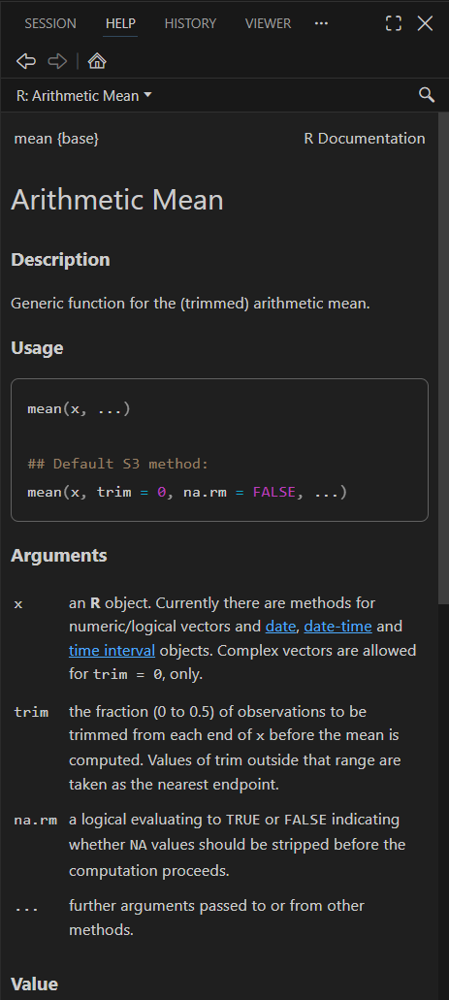
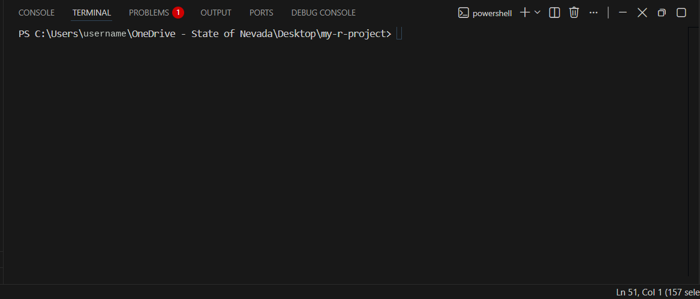
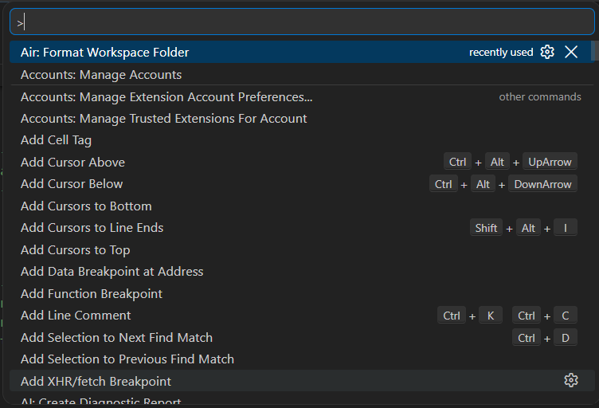

## The layout

{fig-alt="Positron's full window while working in R. Left: the activity bar of icons and the Explorer showing my-r-project. Center top: the editor with demo.r open and plot code selected. Center bottom: the Console showing the R commands that were run. Right top: the Variables pane listing ili as 20 rows by 4 columns, plus counties, n_weeks, and peak_week. Right bottom: the Plots pane showing a line chart titled Weekly ILI (made-up data)."}

| Area | Where | What it's for |
|---|---|---|
| **Activity bar** | Far left, column of icons | Switch the side bar between Explorer, Search, Source Control, Extensions, and more |
| **Side bar** | Left | Shows whatever you picked in the activity bar, usually the **Explorer** |
| **Editor** | Center top | Your scripts and documents, one tab per file |
| **Panel** | Center bottom | **Console**, **Terminal**, Problems, Output |
| **Session** | Right top | **Variables** in your R or Python session |
| **Plots / Help / Viewer** | Right bottom (tabs) | Charts, help pages, and rendered web content |

Drag the borders between areas to resize them. **View → Appearance** shows or hides each part.

## Coming from RStudio or VS Code?

| Positron | RStudio equivalent | VS Code equivalent |
|---|---|---|
| Editor | Source pane | Editor |
| Console | Console | (Python/R extension terminals) |
| Terminal | Terminal tab | Terminal |
| Variables | Environment tab | (Jupyter Variables) |
| Data Explorer | `View()` data viewer | (Data Wrangler extension) |
| Plots | Plots tab | (Plot viewer from extensions) |
| Help | Help tab | (none) |
| Viewer | Viewer tab | (Simple Browser) |
| Explorer | Files tab | Explorer |
| Source Control | Git tab | Source Control |
| Folder (top right) | Project menu (`.Rproj`) | Open Folder |
| Interpreter picker (top right) | R version in Global Options | Python interpreter picker |
| Command Palette (**Ctrl + Shift + P**) | (none; Tools menu) | Command Palette |

## The activity bar

{fig-alt="Positron's activity bar: a vertical column of icons on the far left of the window, starting with Explorer, Search, Data Connections, Source Control, Run and Debug, Remote Explorer, and Extensions, followed by icons added by extensions." width="6%"}

From the top, the main icons are **Explorer**, **Search**, **Data Connections** (databases), **Source Control** (Git), **Run and Debug**, **Remote Explorer**, and **Extensions**. Icons below those come from extensions. **Hover over any icon** to see its name and shortcut.

## Console

Where R or Python runs. Type a command and press **Enter**, or send lines from a script with **Ctrl + Enter**.

{fig-alt="The Console after running code on made-up ILI data. It shows head(ili) printing the first six rows (week, county, visits, pct_ili), summary(ili$pct_ili) showing minimum 1.5, median 2.2, mean 2.685, and maximum 4.6, and mean(ili$pct_ili) returning 2.685."}

- **↑** brings back previous commands.
- The folder path at the top of the Console is the **working directory**.
- The **↻** button restarts the session; the 🗑 button clears the Console.

## Variables and the Data Explorer

The **Variables** pane lists everything in your session: data frames under **Data**, and single values under **Values**.

{fig-alt="The Variables pane showing one data frame, ili, described as 20 rows, with a table icon at the right end of its row." width="35%"}

Click the **table icon** next to a data frame (or run `View(ili)`) to open it in the **Data Explorer**:

{fig-alt="The Data Explorer showing the ili data in a 'Data: ili' tab. On the left, a summary of each column (week, county, visits, pct_ili) with small distribution charts and 0% missing. On the right, a table of the rows with columns week, county, visits, and pct_ili. The bottom shows 20 rows, 4 columns."}

- The **left side** summarizes each column: type, missing values, and a small chart.
- Click a **column header** to sort; use **Filter** to filter rows.
- **Convert to Code** writes the R code for your sort and filter.

## Plots

Charts appear in the **Plots** pane. Use the arrows to flip between earlier plots, and the icons to save, copy, or open a plot in a new window.

{fig-alt="The Plots pane showing a line chart titled Weekly ILI (made-up data), with percent of visits for ILI on the y-axis and weeks from October to February on the x-axis. The line rises from about 1.5% in October to a peak near 4.5% in December, then falls. Toolbar buttons above the plot include back and forward arrows, save, copy, and zoom." width="50%"}

## Help

Run `?` followed by a function name, like `?mean`, to open its help page in the **Help** tab.

{fig-alt="The Help pane showing the R documentation page for mean, titled Arithmetic Mean, with Description, Usage, and Arguments sections." width="40%"}

## Terminal

The **Terminal** tab (next to Console) is a command line: **PowerShell** by default on Windows. Use it for Git commands, `quarto render`, or `pip install`. It does **not** run R code directly.

{fig-alt="The Terminal tab in the bottom panel, showing a PowerShell prompt in the my-r-project folder. The terminal type, powershell, is shown at the top right of the panel."}

## Command Palette

**Ctrl + Shift + P** opens the **Command Palette**: a searchable list of *every* command in Positron. If you can't find a menu option, search for it here.

{fig-alt="The Command Palette open at the top of the window: a search box starting with a > sign, above a list of commands such as Accounts: Manage Accounts, Add Cursor Above with its shortcut Ctrl+Alt+UpArrow, and Add Line Comment with Ctrl+K Ctrl+C." width="60%"}

Try typing `theme`, `new session`, or `preview`.
