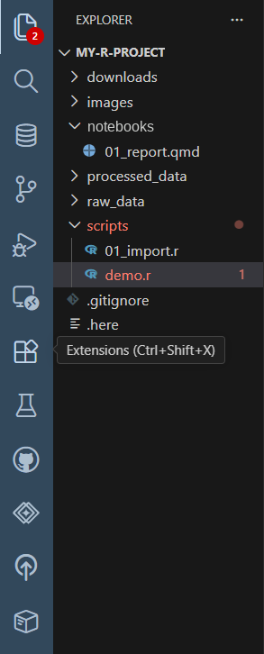
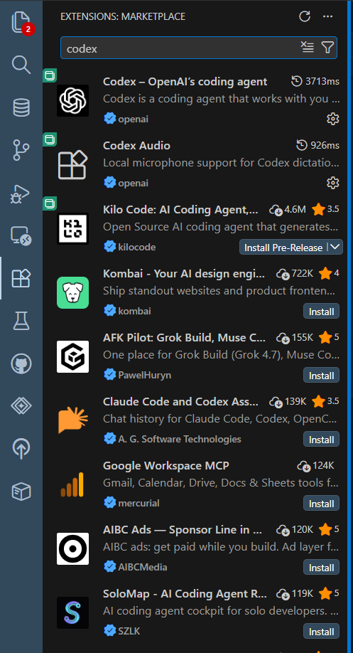

**Extensions** add features to Positron: support for more file types, formatters, themes, and AI assistants.

## Opening the Extensions view

Click the **Extensions** icon in the activity bar, or press **Ctrl + Shift + X**.

::: {.annotated style="max-width:40%"}
{fig-alt="The activity bar with the mouse over the Extensions icon (four squares, one tilted), which is marked with a red circle. A tooltip reads Extensions (Ctrl+Shift+X)."}
[]{.red-circle style="left:2%; top:49.5%; width:18%; height:7.5%;"}
:::

Search for an extension by name, click it to read its description, and click **Install**.

## What's already included

You **don't** need to install these. They're built into Positron:

- **R** support (Console, Variables, Help, code completion)
- **Python** support
- **Quarto** (preview, render, visual editor)
- **Git** / Source Control

## Where extensions come from

Positron installs extensions from the **[Open VSX](https://open-vsx.org/)** marketplace, not Microsoft's VS Code Marketplace. Most popular extensions are on both, but a few Microsoft-only ones (like Pylance) aren't available. See [Troubleshooting](troubleshooting.qmd#my-vs-code-extensions-arent-here) if one is missing.

::: {.callout-warning title="Install with care"}
Extensions can read your files and run code. Stick to well-known extensions with a **verified publisher** (✓ next to the name) and many downloads, and check with IT if you're unsure.
:::

## Some useful extensions

| Extension | What it does |
|---|---|
| **Rainbow CSV** | Colors CSV columns so they're easier to read |
| **Code Spell Checker** | Flags typos in code comments and Markdown |
| **GitHub Pull Requests** | Review and manage pull requests without leaving Positron |
| **Markdown All in One** | Shortcuts and a table of contents for Markdown files |

## AI coding assistants

AI assistants can explain code, suggest changes, and write code from a description. Two are available as extensions:

- **Codex** by **OpenAI**
- **Claude Code** by **Anthropic**

Search for `codex` or `claude` in the Extensions view.

{fig-alt="The Extensions marketplace searched for 'codex'. The first result is Codex – OpenAI's coding agent, published by openai with a verified checkmark, followed by other AI extensions from various publishers." width="45%"}

Both let you **sign in with an enterprise (organization) account**, which keeps your work under your agency's agreement rather than a personal account.

::: {.callout-important title="Before using an AI assistant at work"}
- Use only tools and accounts your agency has **approved**, and sign in with your **enterprise account**.
- **Never** share real data, PHI or PII, passwords, or API keys with an AI assistant.
- Review everything it writes before you run or commit it. You're responsible for the code.
:::
