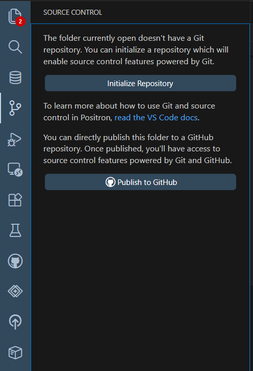
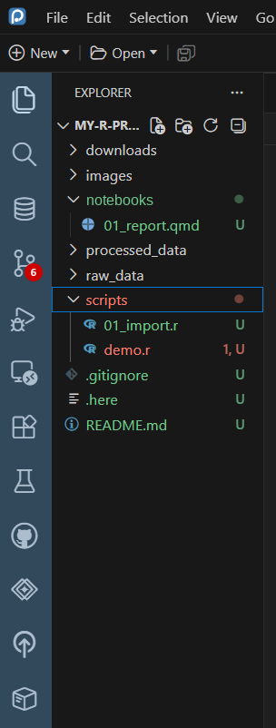
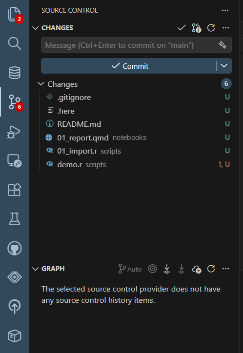

Positron has Git built in, in the **Source Control** view. It does the same things as GitHub Desktop. Use whichever you prefer. If you're new to Git, start with the [Git and GitHub training](../intro-to-github/index.qmd).

::: {.callout-note title="You need Git installed"}
Install [Git for Windows](https://git-scm.com/download/win) first (accept the defaults), then restart Positron.
:::

## 1. Add a `.gitignore` first

Before Git sees anything, list what it must **never** track. Create a file called `.gitignore` at the top of the project ([Lesson 4](04-files-folders.qmd#creating-files)) with:

```
# Data: never in Git
raw_data/
processed_data/
downloads/

# Secrets
.Renviron
.env

# R and Quarto clutter
.Rhistory
.RData
.Rproj.user/
/.quarto/
*_files/
```

Adjust it for your project. See [.gitignore](../intro-to-github/03-repositories-readme-gitignore.qmd#gitignore) in the Git training.

## 2. Initialize the repository

Click the **Source Control** icon in the activity bar (**Ctrl + Shift + G**). In a folder that isn't a Git repository yet, you'll see:

::: {.annotated style="max-width:45%"}
{fig-alt="The Source Control view in a folder without Git. It explains that the folder doesn't have a Git repository, and offers two buttons: Initialize Repository (marked with a red box) and Publish to GitHub."}
[]{.red-box style="left:16.5%; top:19.5%; width:77%; height:5.5%;"}
:::

Click **Initialize Repository**. Your project is now tracked by Git, on your computer only.

## 3. See what changed

The Explorer and Source Control now mark files by status:

{fig-alt="The Explorer after initializing Git. New files are shown in green with a U at the right, a file with a problem is red, and a Source Control icon in the activity bar shows a badge with the number 6." width="35%"}

| Letter | Meaning |
|---|---|
| **U** | Untracked: a new file Git hasn't saved yet |
| **M** | Modified since the last commit |
| **A** | Added (staged) |
| **D** | Deleted |

The number on the Source Control icon is how many files have changes.

**Check the list.** If you see a data file, a `.Renviron`, or anything sensitive, **don't commit**: add it to `.gitignore` first.

## 4. Commit

::: {.annotated style="max-width:45%"}
{fig-alt="The Source Control view with six changed files listed, each marked U: .gitignore, .here, README.md, 01_report.qmd in notebooks, 01_import.r in scripts, and demo.r in scripts. At the top is a Message box (green box) and a Commit button (red box)."}
[]{.green-box style="left:16.5%; top:10.3%; width:78%; height:5%;"}
[]{.red-box style="left:16.5%; top:16.3%; width:78%; height:5.2%;"}
:::

1. Type a **commit message** in the Message box (green), e.g., `Set up project structure`.
2. Click **Commit** (red). If Positron asks whether to stage all changes, choose **Yes** (or click **+** next to each file to stage only some).

The commit is saved on your computer.

## 5. Publish to GitHub (use GitHub Desktop)

For the **first** publish, use **GitHub Desktop**. Its **Organization** dropdown and **Keep this code private** checkbox make it clear where the repository goes:

1. In GitHub Desktop: **File → Add local repository**, and choose your project folder. Because you already initialized Git in Positron, it's added straight away.
2. Click **Publish repository**.
3. Set **Organization** to **nv-ose** and keep **Keep this code private** checked ([details](../intro-to-github/04-github-desktop.qmd#publishing-choose-the-organization)).

::: {.callout-warning title="Why not Publish to GitHub in Positron?"}
Positron's **Publish to GitHub** button works, but it's easy to publish to your **personal account** by mistake, or to make the repository public. If you use it, check the repository's owner and visibility on github.com afterward, and [transfer it to nv-ose](../intro-to-github/04-github-desktop.qmd#publishing-choose-the-organization) if needed.
:::

Once the repository is on GitHub, you can do everything else from Positron's Source Control view.

After that, the everyday loop is:

1. **Commit** your changes.
2. **Sync** (the ↻ button, or **Sync Changes**) to push your commits to GitHub and pull others'.

## Positron or GitHub Desktop?

Both work on the same repository, so you can switch at any time. Many people **edit and commit in Positron** and use **GitHub Desktop** for publishing, branches, and pull requests. Pick what's comfortable.
